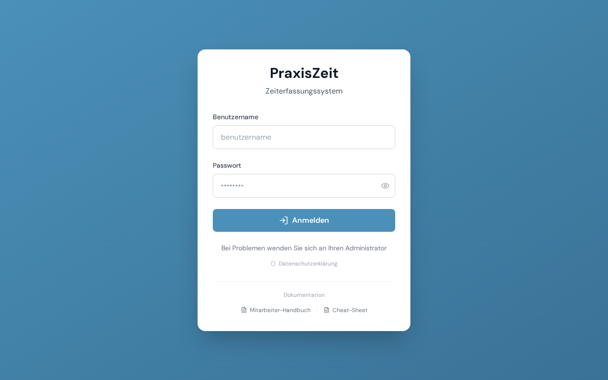
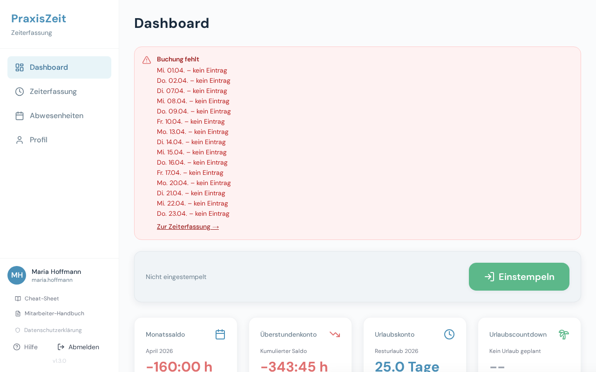
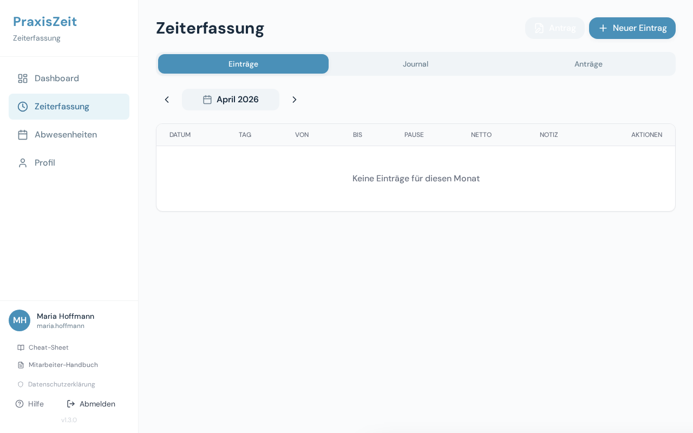
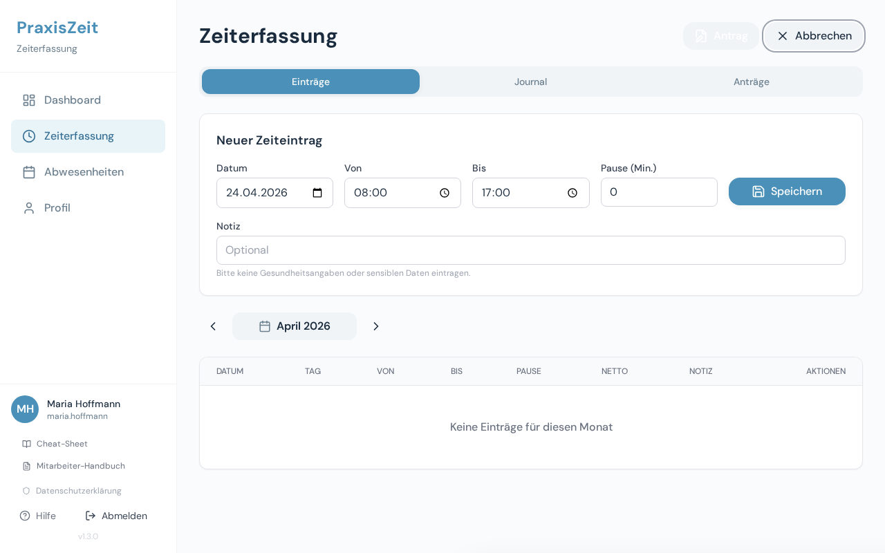
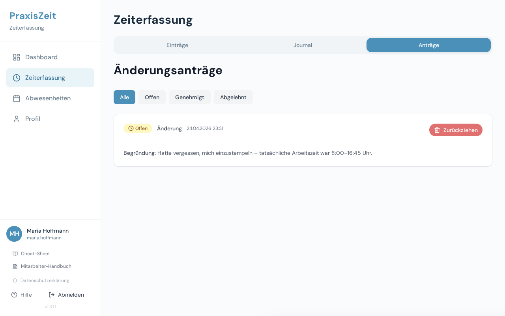
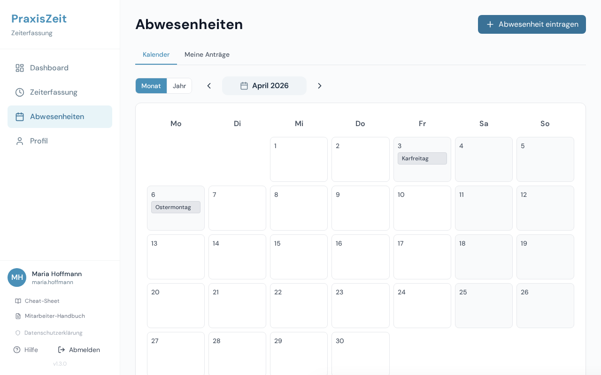
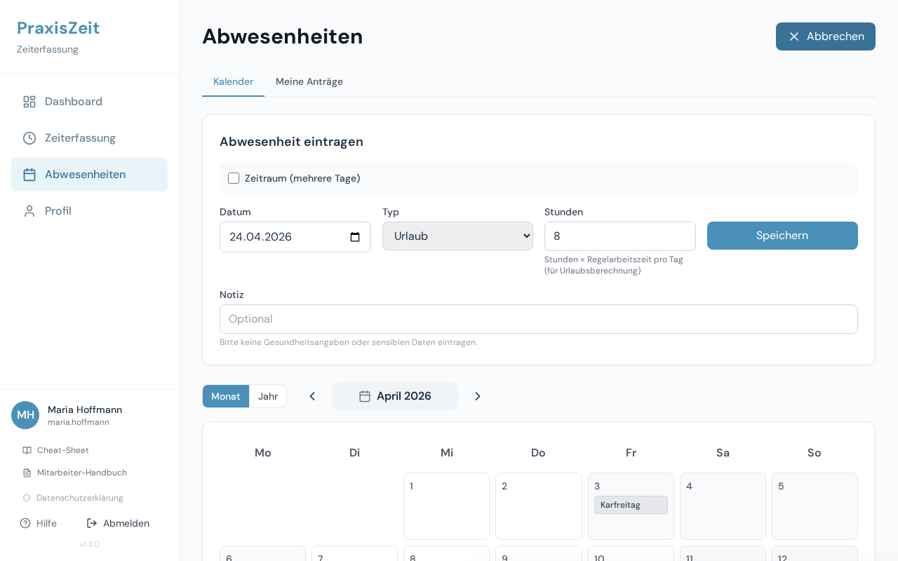
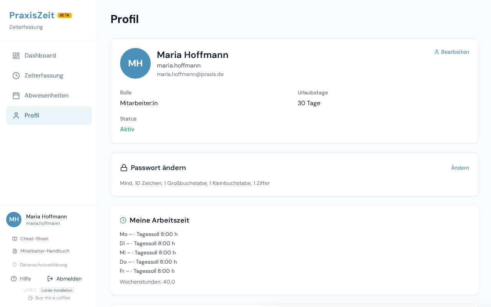
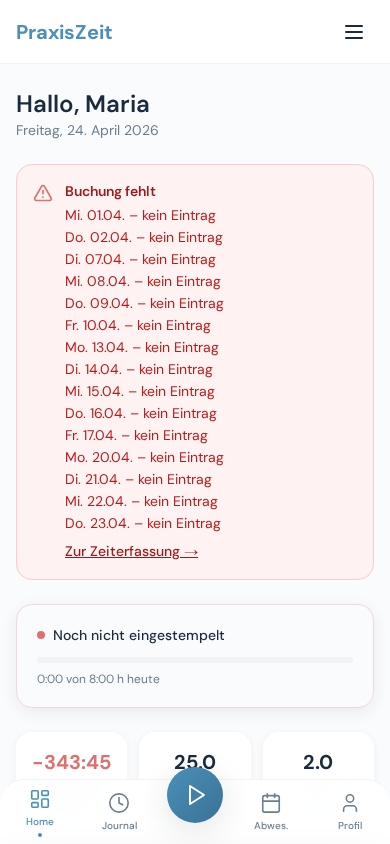
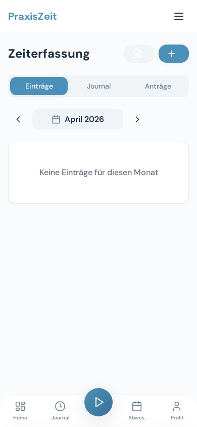

# PraxisZeit – Mitarbeiter-Handbuch

**Version:** 2.9 · **Stand:** Oktober 2026 (PraxisZeit 1.20.0)
**System:** PraxisZeit Zeiterfassungssystem
**Zugangsdaten:** Benutzername und Passwort vom Administrator

---

## Inhaltsverzeichnis

1. [Anmelden](#1-anmelden)
2. [Dashboard – Die Übersicht](#2-dashboard--die-übersicht)
3. [Zeiterfassung](#3-zeiterfassung)
   - 3.1 [Ein- und Ausstempeln (Stoppuhr)](#31-ein--und-ausstempeln-stoppuhr)
   - 3.2 [Arbeitszeit von Hand eintragen](#32-arbeitszeit-von-hand-eintragen)
   - 3.3 [Arbeitszeit-Blöcke und Anrechnung](#33-arbeitszeit-blöcke-und-anrechnung)
   - 3.4 [Eintrag bearbeiten oder löschen](#34-eintrag-bearbeiten-oder-löschen)
   - 3.5 [Korrekturantrag stellen](#35-korrekturantrag-stellen)
   - 3.6 [Anträge verwalten (Anträge-Tab)](#36-anträge-verwalten-anträge-tab)
4. [Abwesenheiten](#4-abwesenheiten)
   - 4.1 [Abwesenheit eintragen](#41-abwesenheit-eintragen)
   - 4.2 [Urlaubsantrag stellen (bei Genehmigungspflicht)](#42-urlaubsantrag-stellen-bei-genehmigungspflicht)
   - 4.3 [Abwesenheit löschen](#43-abwesenheit-löschen)
   - 4.4 [So wird Ihr Urlaub berechnet](#44-so-wird-ihr-urlaub-berechnet)
   - 4.5 [Betriebsferien (Praxisschließung)](#45-betriebsferien-praxisschließung)
5. [So berechnet PraxisZeit Ihre Stunden und Ihren Urlaub](#5-so-berechnet-praxiszeit-ihre-stunden-und-ihren-urlaub)
6. [Wenn für Sie keine Stunden gezählt werden](#6-wenn-für-sie-keine-stunden-gezählt-werden)
7. [Profil & Passwort](#7-profil--passwort)
8. [Mobil-Nutzung](#8-mobil-nutzung)
9. [Häufige Fragen (FAQ)](#9-häufige-fragen-faq)

---

## 1. Anmelden

Öffnen Sie PraxisZeit im Browser unter der Adresse, die Ihnen Ihr Administrator mitgeteilt hat (z. B. `http://praxiszeit.meinepraxis.de`).

**So melden Sie sich an:**

1. Geben Sie Ihren **Benutzernamen** ein (z. B. `maria.hoffmann`)
2. Geben Sie Ihr **Passwort** ein
3. Klicken Sie auf **Anmelden**

> **Passwort vergessen?** Wenden Sie sich an Ihren Administrator.
> Am unteren Rand der Seite finden Sie unter „Dokumentation" direkte Download-Links zum Handbuch und Cheat-Sheet.

---

## 2. Dashboard – Die Übersicht

Nach der Anmeldung gelangen Sie automatisch zum Dashboard.

Das Dashboard zeigt Ihnen auf einen Blick:

### Kacheln (oben)

| Kachel | Was wird angezeigt |
|--------|-------------------|
| **Tagessaldo** | Heutige Ist-Zeit vs. Tagessoll. Gezählt werden **alle** heute erfassten Einträge – bei geteiltem Dienst also Vormittag **und** Nachmittag, auch nach dem Ausstempeln; solange Sie eingestempelt sind, zählt die Anzeige minütlich mit – mit Arbeitszeit-Blöcken wie beim Ausstempeln nur die angerechnete Zeit: die Pause zwischen den Blöcken und die Zeit nach dem letzten Block (plus Puffer) zählt nicht mit (grün = eingestempelt, rot = an einem Arbeitstag heute noch gar nicht eingestempelt, neutral „Ausgestempelt" = heute schon gearbeitet, gerade nicht eingestempelt). An Feiertagen, bei ganztägiger Abwesenheit (Urlaub, Krankheit, Fortbildung, Überstundenausgleich …), vor dem Eintritt und an einem freien 24./31.12. gibt es heute kein Tagessoll – dann erscheint weder Rot noch „x von y". Ein halber Urlaubstag oder ein halber 24./31.12. halbiert das Tagessoll. Sind Arbeitszeit-Blöcke für Sie hinterlegt und Sie sind in der geplanten Pause zwischen zwei Blöcken nicht eingestempelt, zeigt die Karte neutral „Pause zwischen den Arbeitsblöcken" statt Rot |
| **Monatssaldo** | Soll- vs. Ist-Stunden des aktuellen Monats (H:MM) |
| **Überstundenkonto** | Kumulierter Jahressaldo aller Monate |
| **Urlaubskonto** | Budget, verbrauchte und verbleibende Urlaubstage |
| **Urlaubscountdown** | Tage bis zu Ihrem nächsten Urlaub oder zur nächsten Praxisschließung, an der Sie teilnehmen – das frühere Datum zählt |

> **Monatssaldo nur bis zum letzten Arbeitstag:** Im **laufenden** Monat wird das Soll nur bis zum **letzten abgeschlossenen Arbeitstag** gezählt – Sie starten den Monat also **nicht** mit einem dicken Minus, sondern der Saldo baut sich Tag für Tag auf. Der heutige Tag zählt mit, sobald Sie **ausgestempelt** haben. Für **abgeschlossene** Monate entspricht der Saldo wie gewohnt dem vollen Monat. Das **Überstundenkonto** übernimmt für den laufenden Monat denselben Stichtag – auch hier entsteht am Monatsanfang kein künstliches Minus.

> **Voraussichtlicher Stand zum Jahresende:** Neben Ihrem **Überstundenkonto** steht, wie es zum 31.12. voraussichtlich aussieht – Ihr Saldo bis heute abzüglich der Stunden Ihrer bereits eingetragenen künftigen **Überstundenausgleich**-Tage. So sehen Sie sofort, ob die schon geplanten freien Tage Ihr Konto wie gewünscht abbauen. Urlaub, Krankheit und Fortbildung senken das Konto nicht und fließen deshalb nicht in die Vorschau ein. Ihre Praxisleitung kann diese Anzeige abschalten – fehlt die Zeile, ist entweder kein künftiger Ausgleichstag eingetragen oder die Anzeige in den Einstellungen deaktiviert.

> **Hinweis auf offenen Urlaub (ab Oktober):** Im letzten Quartal zeigt das **Urlaubskonto** einen gelben Hinweis „Noch … Urlaubstage offen!" mit der Frist – aber erst, wenn noch **mindestens ein ganzer Urlaubstag** offen ist. Kleinere Reste (z. B. 0,5 Tage bei Teilzeit) lösen keinen Hinweis aus; sie stehen unverändert in Ihrem Urlaubskonto.

> **Auf dem Smartphone** steht oben die Stempelkarte mit „x von y h heute" (Tagessaldo, siehe oben) und darunter die Karte **„Letzte Einträge"** mit Ihren fünf **neuesten** Zeiteinträgen – der jüngste zuerst, auch über den Monatswechsel hinweg (am Monatsersten stehen dort die letzten Einträge des Vormonats). Alle Einträge finden Sie über „Alle anzeigen →" in der Zeiterfassung.

> **Zeitanzeige:** Stunden werden im Format H:MM angezeigt (z. B. „8:30" für 8 Stunden 30 Minuten). Negative Salden werden mit einem Minus-Zeichen dargestellt (z. B. „-2:15").

> **Hinweis:** Falls Ihre Praxis für Sie **keine Stundenzählung** führt, fehlen die Kacheln **Tagessaldo**, **Monatssaldo** und **Überstundenkonto** – das ist bei Ihnen so eingestellt und kein Fehler. Ihr **Urlaubskonto** wird trotzdem geführt. Mehr dazu in [Abschnitt 6](#6-wenn-für-sie-keine-stunden-gezählt-werden).

> **Minijob mit festem Monats-Soll:** Führt Ihre Praxis Sie als Minijob-Kraft mit einer **festen vereinbarten Monatsarbeitszeit** (statt eines aus Wochenstunden berechneten Solls), zeigt Ihr **Monatssaldo** jeden Monat dasselbe feste Soll (bei unterjährigem Ein-/Austritt anteilig gekürzt). Feiertage sowie Urlaub oder bezahlte Freistellung an einem für Sie geplanten Arbeitstag werden Ihnen dabei automatisch mit den geplanten Stunden gutgeschrieben; unbezahlt freie Tage mindern das Monatssoll entsprechend. Unter dem **Überstundenkonto** kann in diesem Fall ein gelber Hinweis erscheinen, wenn die vereinbarte Zeit deutlich überschritten wird oder ein Zeitguthaben zu lange nicht ausgeglichen wurde (§ 2 Abs. 2 MiLoG) – das ist eine reine Information und blockiert nichts. Ob dieses Modell für Sie gilt, legt Ihre Praxisleitung fest.

> **Hinweis bei Änderungen Ihrer Arbeitszeit:** Ändert die Verwaltung Ihre Arbeitszeit (Wochenstunden, Tagesplan oder Arbeitszeit-Blöcke), sehen Sie 30 Tage lang auf dem Dashboard den Kasten **„Hinweis zu Ihrer Arbeitszeit"** – auch wenn die Änderung erst in der Zukunft gilt, zurückgesetzt oder wieder gelöscht wurde. Je nach Fall lautet er z. B.:
>
> - *„Ihre Arbeitszeit wurde ab 01.09.2026 geändert (neu: Mo 08:00–12:00 + 15:00–17:00 / Di 08:00–12:00 / Do 08:00–12:00). 3 Einträge neu berechnet, angerechnete Zeit −2:15 h. Überstundenkonto im Zeitraum +1:45 h. Rückwirkende Verkürzung – Grund: Arbeitszeit war falsch hinterlegt (Fehlerkorrektur)."*
> - *„Ihre Arbeitszeit ändert sich ab 01.11.2026 (neu: 25,0 h/Woche)."* – ändern sich dabei Ihre Arbeitstage pro Woche, steht das mit dabei, z. B. „(neu: 40,0 h/Woche auf 4 Arbeitstage)". Bleibt dabei ein aus früheren Versionen übernommenes Arbeitszeit-Fenster bestehen, folgt es mit dem Zusatz „(nur Kappung)" (→ [Abschnitt 3.3](#33-arbeitszeit-blöcke-und-anrechnung)).
> - *„Die Arbeitszeit-Änderung ab 01.09.2026 wurde ab 09.10.2026 auf den vorherigen Stand zurückgesetzt (neu: …)."* bzw. nach dem Löschen *„Die Arbeitszeit-Änderung ab 01.09.2026 wurde zurückgenommen."*
>
> „Neu berechnet" heißt: Ihre bereits erfassten Einträge im betroffenen Zeitraum wurden mit der neuen Arbeitszeit neu angerechnet – Ihre Stempelzeiten bleiben dabei unverändert gespeichert. Anzahl, angerechnete Zeit und Überstundenkonto stehen nur dabei, wenn sich etwas geändert hat; bei einer rückwirkenden Verkürzung nennt der Hinweis die Art des Grundes. Über den Link **„Arbeitszeit im Profil ansehen"** gelangen Sie zu Profil → „Meine Arbeitszeit" (→ [Abschnitt 7](#7-profil--passwort)).

### Monats-/Wochenübersicht (Tabelle)

Zeigt die vergangenen Monate mit Soll, Ist, Saldo und kumuliertem Überstundenkonto – die neueste Zeile steht oben.

Über den Umschalter **„Monat / Woche"** rechts über der Tabelle wechseln Sie zur **Wochenübersicht**: die letzten **8 Kalenderwochen** (z. B. „KW 41 · 05.–11.10."), je Woche Soll, Ist, Saldo und der Stand Ihres Überstundenkontos am Wochenende. Pro Woche fällt sofort auf, wenn etwas fehlt – etwa ein vergessener Nachmittags-Eintrag oder ein Eintrag, der nicht beendet wurde und automatisch um 23:59 geschlossen wurde. Die **laufende Woche** zählt wie der Monatssaldo nur **bis heute** (bis zum letzten abgeschlossenen Arbeitstag; heute zählt mit, sobald Sie ausgestempelt haben). Ihre Auswahl bleibt auf diesem Gerät/Browser gespeichert.

- **Grün** = Plusstunden
- **Rot** = Minusstunden

### Jahresübersicht

Zeigt die Abwesenheitstage des laufenden Jahres nach Typ (Urlaub, Krank, Fortbildung, Überstundenausgleich, Sonstiges).

### Geplante Abwesenheiten im Team

Übersicht der in den nächsten 3 Monaten geplanten Abwesenheiten Ihrer Kolleginnen und Kollegen.

---

## 3. Zeiterfassung

Klicken Sie in der linken Navigation auf **Zeiterfassung**.

Die Seite gliedert sich in **drei Tabs**:

| Tab | Inhalt |
|-----|--------|
| **Einträge** | Monatsübersicht aller Zeiteinträge + Eingabeformular |
| **Journal** | Tagesjournal-Ansicht der Einträge |
| **Anträge** | Ihre gestellten Änderungsanträge |

**Spalten der Einträge-Tabelle:**

| Spalte | Bedeutung |
|--------|-----------|
| **Datum** | Arbeitstag |
| **Tag** | Wochentag (Mo, Di, ...) |
| **Von** | Arbeitsbeginn |
| **Bis** | Arbeitsende |
| **Pause** | Pausenzeit in Minuten |
| **Netto** | Angerechnete Arbeitszeit nach Abzug der Pause – bei Arbeitszeit-Blöcken ohne die nicht angerechnete Zeit (→ [Abschnitt 3.3](#33-arbeitszeit-blöcke-und-anrechnung)) |
| **Notiz** | Optionaler Kommentar |
| **Aktionen** | Bearbeiten, Löschen, Korrekturantrag |

**Monat wechseln:** Mit den Pfeilen `<` und `>` neben dem Monatsnamen blättern Sie zwischen den Monaten.

> **Rechtlicher Hintergrund:** Die Aufzeichnungspflicht ergibt sich aus
> [§ 16 Abs. 2 ArbZG](https://www.gesetze-im-internet.de/arbzg/__16.html).
> PraxisZeit dokumentiert alle täglichen Zeiten und hält sie für 2 Jahre vor.

---

### 3.1 Ein- und Ausstempeln (Stoppuhr)

Am einfachsten erfassen Sie Ihre Arbeitszeit live mit der Stempeluhr. Sie finden den **Einstempeln**-Button auf dem Dashboard (am Smartphone zusätzlich über den großen Knopf unten in der Mitte).

**So stempeln Sie ein:**

1. Klicken bzw. tippen Sie auf **Einstempeln**.
2. Die Uhr beginnt zu laufen und zeigt Ihre heutige Arbeitszeit live an.

**So stempeln Sie aus:**

1. Klicken bzw. tippen Sie auf **Ausstempeln**.
2. Es erscheint ein Feld **Pause (Min.)** – tragen Sie hier ein, wie viele Minuten Pause Sie heute gemacht haben (z. B. `30`).
3. Klicken bzw. tippen Sie auf **Jetzt ausstempeln**.

> **Wichtig – Pause nacherfassen (§ 4 ArbZG):**
> Wenn Sie an einem Tag **mehr als 6 Stunden** gearbeitet haben, schreibt das Gesetz eine Pause vor (mind. 30 Min. bei mehr als 6 h, mind. 45 Min. bei mehr als 9 h). Tragen Sie deshalb beim Ausstempeln Ihre tatsächliche Pause ein.
>
> Reicht die eingetragene Pause nicht aus, erscheint ein gelber Hinweis. Sie haben dann **zwei Möglichkeiten**:
> 1. **Pause oben nachtragen** – wenn Sie tatsächlich länger Pause gemacht haben, korrigieren Sie einfach die Minuten.
> 2. **Begründung angeben** – falls eine Pause wirklich nicht möglich war, schreiben Sie in das Textfeld kurz, warum (z. B. „Notfall, keine Vertretung"). Diese **dokumentierte Ausnahme** wird gespeichert, und Sie können danach normal ausstempeln.
>
> Anders als früher genügt also kein flüchtiger Hinweis mehr – Sie müssen entweder die Pause eintragen **oder** die Ausnahme begründen, bevor das Ausstempeln abgeschlossen wird.
>
> **Der ganze Tag zählt:** Geprüft wird nicht nur der gerade laufende Abschnitt, sondern alle Einträge des Tages zusammen. Wer z. B. um 13:59 aus- und sofort wieder einstempelt, hat **keine** Pause gemacht – eine Unterbrechung zählt erst ab **15 Minuten** als Pause. Stempeln Sie abends nach insgesamt mehr als 6 bzw. 9 Stunden aus, verlangt PraxisZeit die Pause deshalb auch dann, wenn der letzte Abschnitt für sich kurz war.
>
> **Keine Begründung angeboten?** Ihre Praxis kann die Ausnahme „Pflicht-Pause war nicht möglich" abschalten. Dann fehlt das Textfeld, und das Ausstempeln klappt nur mit eingetragener Pause.

> **Verschrieben?** Mit **Abbrechen** schließen Sie das Pausenfeld wieder, ohne auszustempeln – die Uhr läuft weiter.

---

### 3.2 Arbeitszeit von Hand eintragen

Wenn Sie heute nicht gestempelt haben, klicken Sie oben rechts auf **+ Neuer Eintrag**. Einen **vergangenen Tag** tragen Sie hier nicht nach, sondern beantragen ihn: über den Button **Antrag** links daneben oder im **Journal** über das **+** in der Zeile des Tages (→ [Abschnitt 3.5](#35-korrekturantrag-stellen)).

Das Eingabeformular erscheint direkt oberhalb der Eintrags-Tabelle.

**Felder ausfüllen:**

1. **Datum** – Vorbelegt: heute. Speichern können Sie hier nur einen Eintrag für heute; bei einem anderen Datum erscheint *„Einträge für vergangene Tage können nur per Änderungsantrag erstellt werden"*.
2. **Von** – Arbeitsbeginn (Format: `08:00`)
3. **Bis** – Arbeitsende (Format: `17:00`)
4. **Pause (Min.)** – Pausenzeit in Minuten (z. B. `30`)
5. **Notiz** – Optional: Anmerkung zum Tag (keine Gesundheitsdaten eintragen)
6. **Ausnahmegrund** – erscheint nur an **Sonn- und gesetzlichen Feiertagen** (§ 10 ArbZG, z. B. „Notdienst")

Klicken Sie auf **Speichern**. Mit **Abbrechen** (oben rechts) verwerfen Sie das Formular.

> **Vorbelegung:** Sind Arbeitszeit-Blöcke für Sie hinterlegt, sind **Von** und **Bis** mit dem Beginn des ersten und dem Ende des letzten Blocks von heute vorbelegt.

> **Warnung bei langen Arbeitszeiten:**
> PraxisZeit prüft Eingaben automatisch auf ArbZG-Einhaltung:
>
> - **> 8 Stunden Netto:** Hinweis gem. [§ 3 ArbZG](https://www.gesetze-im-internet.de/arbzg/__3.html)
> - **> 10 Stunden Netto:** Bei **manueller Eingabe** (wie hier) wird der Eintrag blockiert (Tageshöchstgrenze). Beim **Live-Ausstempeln** wird stattdessen nur gewarnt — die Zeit ist dann bereits geleistet und § 16-aufzeichnungspflichtig.
> - **Zu kurze Pause** gem. [§ 4 ArbZG](https://www.gesetze-im-internet.de/arbzg/__4.html) (bei > 6h → mind. 30 Min.; bei > 9h → mind. 45 Min.), gerechnet über **alle** Einträge des Tages; Lücken unter 15 Min. zählen nicht als Pause: Speichern erst mit ausreichender Pause oder – falls Ihre Praxis es erlaubt – mit Begründung („Pflicht-Pause war nicht möglich"). Je nach Einstellung Ihrer Praxis wird ein so begründeter Eintrag erst nach Genehmigung durch die Verwaltung wirksam. Ändern Sie beim Bearbeiten nur die Notiz (Zeiten und Pause bleiben gleich), sperrt die Pausenregel nicht erneut; eine schon dokumentierte Begründung bleibt ohne neue Genehmigung stehen.

---

### 3.3 Arbeitszeit-Blöcke und Anrechnung

Ihre Praxis kann Ihre Arbeitszeit je Wochentag (Mo–Fr) als **Arbeitszeit-Blöcke** hinterlegen, z. B. „Montag 08:00–12:00 und 15:00–18:00". Ihr Tagessoll ergibt sich dann aus den Blöcken (→ [Abschnitt 5](#ihr-tagessoll)). Ihre heute gültigen Blöcke und alle Änderungen sehen Sie unter **Profil → „Meine Arbeitszeit"** (→ [Abschnitt 7](#7-profil--passwort)).

> **Übernommenes Arbeitszeit-Fenster:** Hat Ihre Praxis vor Version 1.20.0 ein Arbeitszeit-Fenster (Soll-Beginn/Soll-Ende) für Sie hinterlegt, gilt es als ein Block je Tag weiter, bis die Verwaltung es umstellt. Es begrenzt die Anrechnung wie unten beschrieben; Ihr Tagessoll kommt aber weiter aus Ihren Wochenstunden bzw. Tagesstunden, nie aus dem Fenster. Die Karte „Meine Arbeitszeit" zeigt dann z. B. „Mo 07:30–16:30 · Tagessoll 8:00 h" und darunter *„Diese Zeiten begrenzen nur die Anrechnung der erfassten Zeit; das Tagessoll wird nicht aus ihnen berechnet."* War nur ein Beginn oder nur ein Ende hinterlegt, steht für die fehlende Seite 00:00 bzw. 23:59. Ändert die Verwaltung Ihre Wochenstunden oder Tagesstunden und bleibt das Fenster bestehen, nennt der Dashboard-Hinweis (→ [Abschnitt 2](#2-dashboard--die-übersicht)) es mit dem Zusatz „(nur Kappung)", z. B. *„Ihre Arbeitszeit ändert sich ab 01.11.2026 (neu: 40,0 h/Woche · Mo 07:30–16:30 / Fr 07:30–23:59 (nur Kappung))."*

Angerechnet wird Ihre gestempelte Zeit **innerhalb** der Blöcke – mit einem kleinen **Puffer** (Standard 15 Minuten) an jedem Blockrand:

- **Zu früh eingestempelt:** Stempeln Sie deutlich **vor Ihrem ersten Block** ein, wird die Zeit davor nicht angerechnet. Beim Einstempeln sehen Sie dann z. B. den Hinweis *„Du hast vor deinem Soll-Beginn eingestempelt — angerechnet ab 07:45."*
- **Noch einmal zu früh eingestempelt:** Haben Sie heute schon einen Eintrag, der um 07:45 beginnt (z. B. nach einem Fehlstempel gleich wieder ausgestempelt), fiele ein erneutes Einstempeln bis 07:45 auf denselben Beginn. PraxisZeit lehnt es dann ab: *„Einstempeln nicht möglich: Ein Zeiteintrag von heute beginnt bereits um 07:45, und der neue Eintrag würde ebenfalls um 07:45 beginnen. Bitte den vorhandenen Eintrag in der Zeiterfassung bearbeiten oder nach 07:45 erneut einstempeln."* Dasselbe gilt ohne Arbeitszeit-Blöcke, wenn Sie in derselben Minute ein-, aus- und wieder einstempeln.
- **Zu spät ausgestempelt:** Zeit deutlich **nach dem letzten Block** (über den Puffer hinaus) wird ebenfalls nicht angerechnet.
- **Durchgestempelt über die Pause zwischen zwei Blöcken:** Die Zeit zwischen den Blöcken wird nicht angerechnet – abzüglich des Puffers an beiden Rändern. Beispiel: Blöcke 08:00–12:00 und 15:00–18:00, gestempelt 08:00–18:00 → angerechnet werden **7:30 h**, die 2:30 h von 12:15 bis 14:45 nicht. Wer um 12:05 ausstempelt, verliert keine Minute. Liegen zwei Blöcke höchstens den doppelten Puffer auseinander (Standard 30 Minuten), wird die Zeit dazwischen ganz angerechnet.
- **Einstempeln in der Pause zwischen zwei Blöcken:** Sie sehen *„Eingestempelt zwischen zwei Arbeitsblöcken (Lücke 12:15–14:45, Puffer 15 Minuten) — angerechnet wird erst ab 14:45."*
- **Ausgestempelt in der Pause:** Sind Sie in der geplanten Pause zwischen zwei Blöcken nicht eingestempelt, zeigt die Stempelkarte auf dem Dashboard neutral „Pause zwischen den Arbeitsblöcken" statt Rot.
- **Wochenende und Feiertage:** Dort gelten keine Blöcke. Arbeiten Sie an einem Samstag, Sonntag oder Feiertag (z. B. Notdienst), wird die ganze Zeit angerechnet.
- **Wochentag ohne Block:** Haben Sie an einem Werktag (Mo–Fr) keinen Block, ist das Ihr freier Tag. Stempeln Sie dort trotzdem, wird die Zeit gespeichert, aber nicht angerechnet: *„An diesem Tag sind keine Arbeitszeit-Blöcke hinterlegt — angerechnet werden 0 Stunden. Die gestempelte Zeit bleibt gespeichert. Haben Sie in dieser Zeit gearbeitet, beantragen Sie die Anrechnung (Zeiterfassung → Eintrag → „Anrechnung beantragen“).“* Angerechnet wird die Zeit erst, wenn die Verwaltung den Antrag genehmigt und anerkennt („Genehmigen und anerkennen“) oder den Eintrag anerkennt. Auch ein vergessenes Ausstempeln an einem solchen Tag zählt 0 h.
- **Beim Ausstempeln und beim Speichern eines eigenen Eintrags** erscheint ein Hinweis, sobald etwas nicht angerechnet wird, z. B. *„Zwischen den Arbeitsblöcken (12:15–14:45, Puffer 15 Minuten eingerechnet) werden 2:30 h nicht angerechnet. Die gestempelte Zeit bleibt unverändert gespeichert. Haben Sie in dieser Zeit gearbeitet, beantragen Sie die Anrechnung (Zeiterfassung → Eintrag → „Anrechnung beantragen“)."* Bei zu frühem Beginn oder zu spätem Ende lautet er z. B. *„Die eingetragene Zeit wurde auf das hinterlegte Arbeitszeit-Fenster gekappt (Beginn 07:00 → 07:45; Puffer 15 Minuten)."* Liegt ein Eintrag ganz in der Lücke, heißt es z. B. *„Die eingetragene Zeit (13:00–14:00) liegt vollständig zwischen zwei Arbeitsblöcken (Lücke 12:15–14:45, Puffer 15 Minuten) — angerechnet werden 0 Stunden. Die gestempelte Zeit bleibt gespeichert."* Der Eintrag wird **trotzdem gespeichert** — der Hinweis blockiert nichts.
- **Pause und Lücke:** Die Zeit zwischen zwei Blöcken zählt für die Pausenpflicht (§ 4 ArbZG) als Pause, sobald nach Abzug des Puffers an beiden Rändern mindestens 15 Minuten übrig bleiben – dann verlangt das Ausstempeln dafür keine zusätzliche Pause. Das gilt aber nur, wenn die Lücke tatsächlich frei war; haben Sie ohne eingetragene Pause durchgestempelt, erinnert Sie daran ein Hinweis, z. B. *„§4 ArbZG: Durchgehend über die Lücke zwischen den Arbeitsblöcken gestempelt – eine Ruhepause ist nicht erfasst (10:00 h Anwesenheit). Die Lücke gilt nur dann als Pause, wenn sie tatsächlich frei war."* Tragen Sie dagegen eine Pause ein, obwohl Sie über die Lücke durchgestempelt haben, wird beides abgezogen; Sie sehen dann *„Pause in der Lücke wird zusätzlich abgezogen: 30 Min Pause und 2:30 h nicht angerechnet zwischen den Arbeitsblöcken. Lag die Pause in der Lücke, bitte die Pause auf 0 setzen."*
- **Vergessen auszustempeln?** Ein offener Eintrag eines vergangenen Tages wird automatisch geschlossen (um 23:59) und nur bis zum Ende Ihres letzten Blocks plus Puffer angerechnet. Tragen Sie das tatsächliche Ende per **Änderungsantrag** nach (→ [Abschnitt 3.5](#35-korrekturantrag-stellen)): Im Antrag steht zunächst das angerechnete Ende (z. B. 18:15) – ersetzen Sie es durch Ihr tatsächliches Ende. Auch ein tatsächliches Ende um **23:59** (z. B. nach einem Spät- oder Notdienst) können Sie eintragen; es gilt dann als echter Stempel und wird wie jedes andere Ende an Ihren Blöcken gekürzt – angerechnet bis 23:59 wird es, wenn die Verwaltung den Eintrag anerkennt. (An einem Werktag ohne Block zählt der automatisch geschlossene Eintrag 0 h. Ist das angerechnete Ende bereits 23:59 – nur dort, wo nichts gekappt wird: Sie haben keine Arbeitszeit-Blöcke, es ist Wochenende oder Feiertag, oder Ihre Stunden werden nicht gezählt –, bleibt die Kennzeichnung „automatisch geschlossen" stehen; angerechnet wird dann ohnehin bis 23:59.) Ebenso bleibt die Kennzeichnung, wenn das eingetragene Ende genau dem angerechneten Ende entspricht (z. B. 18:15) – auch wenn Sie tatsächlich um diese Zeit gegangen sind: PraxisZeit kann es nicht vom automatisch gesetzten Wert unterscheiden, und eine Anrechnung lässt sich für diesen Eintrag dann nicht beantragen.

**So erkennen Sie nicht angerechnete Zeit:** In der Zeiterfassung und im Journal steht unter der Uhrzeit eines Eintrags eine Zusatzzeile:

| Lage | Zusatzzeile |
|------|-------------|
| Beginn oder Ende gekürzt | *„gestempelt 07:30 · angerechnet ab 07:45"* bzw. *„gestempelt 19:00 · angerechnet bis 18:15"* |
| durchgestempelt über die Lücke | *„gestempelt 08:00–18:00 · angerechnet 7:30 h · 2:30 h zwischen den Blöcken nicht angerechnet"* |
| zusätzlich Beginn/Ende gekürzt | *„gestempelt 07:00–19:00 · angerechnet 8:00 h (07:45–18:15) · 4:00 h nicht angerechnet, davon 2:30 h zwischen den Blöcken"* |
| mit eingetragener Pause | „angerechnet 7:00 h" erhält den Zusatz *„nach 0:30 h Pause"* |
| automatisch geschlossen | *„eingestempelt 08:00, nicht ausgestempelt – automatisch geschlossen · angerechnet 7:45 h (08:00–18:15) · 2:30 h zwischen den Blöcken nicht angerechnet"*; ohne Kürzung *„… automatisch geschlossen um 23:59"* |
| anerkannt | Kennzeichen *„anerkannt"*, keine Zusatzzeile |

„Angerechnet" ist die Zeit, die in Ihr Ist und Ihren Saldo eingeht (nach Pause und Lücke). „Nicht angerechnet" ist die Zeit zwischen den Blöcken **plus** die vor dem ersten bzw. nach dem letzten Block abgeschnittene Zeit. Das **Journal** nennt die Summe des Monats als Zeile *„Anwesenheit nicht angerechnet: 7:30 h"* (nur wenn etwas anfällt).

**Haben Sie außerhalb oder zwischen den Blöcken gearbeitet?** Dann beantragen Sie die Anrechnung: Unter einer solchen Zusatzzeile steht in der Zeiterfassung und im Journal der Link **„Anrechnung beantragen"**. Er öffnet einen Änderungsantrag mit Ihren gestempelten Zeiten und dem Hinweis *„Die gesamte gestempelte Zeit soll angerechnet werden. Bitte begründen Sie, warum Sie in dieser Zeit gearbeitet haben."* Das Datum ist dabei fest – die Anrechnung gilt dem Tag des Eintrags. Begründen Sie kurz (z. B. „Patientin nach Sprechstundenende versorgt") und senden Sie den Antrag ab. Bei einem automatisch geschlossenen Eintrag ist das Feld **Bis** leer: Tragen Sie im selben Antrag Ihr tatsächliches Ende ein, sonst erscheint *„Der Eintrag wurde automatisch geschlossen – bitte das tatsächliche Ende angeben."* Dieselbe Meldung erscheint, wenn Sie genau das angerechnete Ende eintragen (z. B. 18:15) – PraxisZeit kann es nicht vom automatisch gesetzten Wert unterscheiden (→ „Vergessen auszustempeln?" oben). Das geht auch für den heutigen Eintrag, aber erst nach Arbeitsende – liegt das Ende noch in der Zukunft, erscheint *„Das Ende liegt in der Zukunft – die Anrechnung kann erst nach Arbeitsende beantragt werden."* Nach dem Absenden sehen Sie *„Antrag auf Anrechnung eingereicht"*; unter **Zeiterfassung → Tab „Anträge"** trägt der Antrag das Kennzeichen **„Anrechnung beantragt"**. Genehmigt die Verwaltung ihn mit Anerkennen, werden die beantragten Zeiten vollständig angerechnet – ohne Kürzung durch die Blöcke –, und dort steht **„anerkannt"**. Steht dort **„ohne Anerkennen genehmigt"**, wurden die beantragten Zeiten übernommen, aber wie bei jedem Eintrag an Ihren Blöcken gekürzt; die Zeit vor, nach oder zwischen den Blöcken bleibt nicht angerechnet. Die Verwaltung kann nicht angerechnete Zeit auch von sich aus anerkennen.

Einen anerkannten Eintrag können Sie nicht mehr selbst bearbeiten oder löschen: Am selben Tag zeigt die Zeiterfassung statt Bearbeiten und Löschen ein Schloss mit dem Hinweis *„Anerkannter Eintrag – Änderung per Änderungsantrag oder über die Verwaltung"* und daneben die Knöpfe für **Änderungsantrag** bzw. **Löschantrag** (→ [Abschnitt 3.5](#35-korrekturantrag-stellen)) – schon am selben Tag, wie bei jedem älteren Eintrag; alternativ wenden Sie sich an die Verwaltung. Ein Änderungsantrag für den heutigen Eintrag behält das Datum und kann kein Ende nach der aktuellen Uhrzeit eintragen (*„Das Ende liegt in der Zukunft – die Änderung kann erst nach Arbeitsende beantragt werden."*). Ändert Ihr Antrag nur die Notiz (Datum, Zeiten und Pause wie gespeichert), lehnt PraxisZeit ihn nicht an § 3 oder § 4 ArbZG ab – auch wenn der anerkannte Eintrag über 10 Stunden liegt oder keine ausreichende Pause hat; geänderte Zeiten oder Pause werden wieder voll geprüft.

> **Ihre echte Stempelzeit geht nicht verloren:** Der Zeitpunkt, zu dem Sie tatsächlich gestempelt haben, bleibt immer gespeichert (gesetzlich vorgeschrieben, § 16 ArbZG). Für Ihr Stundenkonto wird nur die **angerechnete** Zeit verwendet.

> **Nicht angerechnet heißt nicht unbezahlt:** Ob gearbeitete Zeit vergütet wird, entscheidet nicht diese Anrechnung. Arbeit, die angeordnet, gebilligt oder geduldet wurde, ist zu vergüten (§ 611a, § 612 BGB; Mindestlohngesetz). Sprechen Sie Ihre Verwaltung an oder beantragen Sie die Anrechnung.

> **Hinweis:** Diese Begrenzung ist **nur aktiv, wenn Ihre Praxis Arbeitszeit-Blöcke für Sie hinterlegt hat**. Ist nichts hinterlegt, zählt Ihre gestempelte Zeit ganz normal. Ändert die Praxis Ihre Arbeitszeit, sehen Sie 30 Tage lang einen Hinweis auf Ihrem Dashboard (→ [Abschnitt 2](#2-dashboard--die-übersicht)).

---

### 3.4 Eintrag bearbeiten oder löschen

In der Spalte **Aktionen** finden Sie Buttons je nach Zustand des Eintrags:

| Button | Funktion |
|--------|----------|
| **Bearbeiten** | Öffnet das Formular mit den bestehenden Werten (nur für entsperrte, aktuelle Einträge) |
| **Löschen** | Entfernt den Eintrag dauerhaft (nur wenn nicht gesperrt) |
| **Änderungsantrag** | Korrekturantrag stellen (für gesperrte oder ältere Einträge) |
| **Löschantrag** | Antrag auf Löschung eines gesperrten Eintrags stellen |
| **Anrechnung beantragen** (Link unter der Uhrzeit) | Bei eigenen Einträgen mit nicht angerechneter Zeit: Antrag, die ganze gestempelte Zeit anzurechnen (→ [Abschnitt 3.3](#33-arbeitszeit-blöcke-und-anrechnung)) |
| **Schloss** (heute anerkannter Eintrag) | Kein Bearbeiten oder Löschen; Hinweis „Anerkannter Eintrag – Änderung per Änderungsantrag oder über die Verwaltung". Wie jeder ältere Eintrag – auch schon heute – über **Änderungsantrag** bzw. **Löschantrag** |

> **Datum beim Bearbeiten:** Das Datum eines Eintrags können Sie beim Bearbeiten nicht ändern – das Feld ist gesperrt, darunter steht *„Das Datum bleibt beim Bearbeiten fest. Gehört die Zeit zu einem anderen Tag: Eintrag löschen und oben über „Antrag“ einen Änderungsantrag für diesen Tag stellen."* Bearbeiten können Sie nur heutige Einträge, und für die gibt es keinen Änderungsantrag. Ein anderes Datum gibt es deshalb nur per Antrag: Eintrag löschen und oben über den Button **Antrag** einen Eintrag für den richtigen (vergangenen) Tag beantragen. Bei älteren Einträgen ändern Sie das Datum direkt im Änderungsantrag (→ [Abschnitt 3.5](#35-korrekturantrag-stellen)).

> **Warum können ältere Einträge nicht direkt geändert werden?**
> Nach einer Sperrfrist gelten Einträge als bestätigt. Korrekturen erfordern dann einen formellen Antrag (→ [Abschnitt 3.5](#35-korrekturantrag-stellen)).
> Dies dient der Nachvollziehbarkeit gem. [§ 16 ArbZG](https://www.gesetze-im-internet.de/arbzg/__16.html).

---

### 3.5 Korrekturantrag stellen

Wenn ein Eintrag gesperrt ist oder Sie nachträglich eine Korrektur beantragen möchten, klicken Sie in der Zeile des betroffenen Eintrags auf den Button **Änderungsantrag**.

Ein Dialog öffnet sich mit dem Vergleich von aktuellem und gewünschtem Eintrag:

1. Passen Sie die Felder **Datum**, **Von**, **Bis** und **Pause** auf die korrekten Werte an (beim Antrag „Anrechnung beantragen" bleibt das Datum fest, → [Abschnitt 3.3](#33-arbeitszeit-blöcke-und-anrechnung))
2. Tragen Sie eine **Begründung** ein (Pflichtfeld)
3. Klicken Sie auf **Antrag stellen**

Für eine vollständige Löschung eines gesperrten Eintrags klicken Sie stattdessen auf **Löschantrag**, geben eine Begründung ein und bestätigen.

**Vergangener Tag ohne Eintrag** (z. B. vergessen zu stempeln): Klicken Sie oben rechts auf den Button **Antrag** (links neben **+ Neuer Eintrag**). Es öffnet sich der Dialog „Änderungsantrag: Neuer Eintrag (vergangener Tag)": **Datum**, **Von**, **Bis** und **Pause** eintragen, eine **Begründung** angeben und auf **Antrag stellen** klicken. Im **Journal** geht das auch über das **+** in der Zeile des Tages.

> **Sonn- oder Feiertag (§ 10 ArbZG):** Liegt das Datum des Antrags auf einem Sonntag oder gesetzlichen Feiertag, erscheint zusätzlich das Feld **„Ausnahmegrund (§10 ArbZG)"** (z. B. „Notdienst", „Patientenversorgung"). Der Grund wird mit der Genehmigung am Eintrag gespeichert und erscheint in den Exporten. Ein bereits gespeicherter Grund ist beim Änderungsantrag vorausgefüllt.

> **Pflicht-Pause war nicht möglich? (§ 4 ArbZG):**
> Wenn Ihre korrigierten Zeiten die Pausenregel nicht erfüllen (mind. 30 Min. bei mehr als 6 h, mind. 45 Min. bei mehr als 9 h), wird Ihr Antrag **nicht einfach abgelehnt**. Stattdessen erscheint ein zusätzliches Feld **„Pflicht-Pause war nicht möglich – Begründung"**. Tragen Sie dort kurz ein, warum keine ausreichende Pause möglich war (z. B. „Notfall, keine Vertretung verfügbar"), und senden Sie den Antrag mit **Mit dokumentierter Ausnahme senden** ab. Die Abweichung wird dokumentiert und dem Administrator zur Genehmigung vorgelegt.
> Hat Ihre Praxis diese Ausnahme abgeschaltet, erscheint das Feld nicht – tragen Sie dann die Pause in den Antrag ein.

**Was danach passiert:**
- Der Antrag erscheint beim Administrator zur Prüfung
- Sie sehen den Status unter **Zeiterfassung → Tab „Anträge"**
- Bei Ablehnung erhalten Sie eine Begründung

---

### 3.6 Anträge verwalten (Anträge-Tab)

Wechseln Sie im Tab-Menü der Zeiterfassung auf **Anträge**.

Hier sehen Sie alle Ihre gestellten Korrekturanträge mit ihrem aktuellen Status:

| Status | Bedeutung |
|--------|-----------|
| **Offen** | Antrag wartet auf Prüfung durch den Administrator |
| **Genehmigt** | Antrag wurde genehmigt, Zeiteintrag wurde korrigiert |
| **Abgelehnt** | Antrag wurde abgelehnt – Begründung wird angezeigt |

**Filter:** Verwenden Sie die Tabs **Alle / Offen / Genehmigt / Abgelehnt**.

**Antrag zurückziehen:** Solange ein Antrag noch **Offen** ist, können Sie ihn über den Button **Zurückziehen** stornieren.

---

## 4. Abwesenheiten

Klicken Sie in der Navigation auf **Abwesenheiten**.

Die Seite zeigt zwei Tabs:

| Tab | Inhalt |
|-----|--------|
| **Kalender** | Monats- oder Jahresansicht aller Team-Abwesenheiten |
| **Meine Anträge** | Nur sichtbar wenn Genehmigungspflicht aktiv – Ihre Urlaubsanträge |

**Legende der Farben:**

| Farbe | Abwesenheitstyp |
|-------|----------------|
| Blau | Urlaub |
| Rosa/Rot | Krank |
| Orange | Fortbildung |
| Grau | Sonstiges |

> **Sondertage 24./31.12.:** Hat Ihre Praxis Heiligabend oder Silvester als arbeitsfrei oder halben Tag eingestellt, sind diese Tage im Kalender entsprechend markiert (grau „Heiligabend (frei)" bzw. „Silvester (½ Tag)") – ähnlich einem Feiertag.

> **Datenschutz bei Kollegen-Abwesenheiten:** Im Team-Kalender sehen Sie bei **Kolleginnen und Kollegen** nur Urlaub und Fortbildung mit ihrem echten Typ. Krankheit, bezahlte Freistellung, Sonstiges und alle eigenen (individuellen) Abwesenheitsgründe werden bei anderen Personen neutral als **„Abwesend"** angezeigt. Ihre **eigenen** Abwesenheiten sehen Sie natürlich immer mit dem echten Typ, ebenso Administratorinnen und Administratoren.

---

### 4.1 Abwesenheit eintragen

Klicken Sie auf **+ Abwesenheit eintragen**.

**Felder:**

1. **Datum** – Beginn der Abwesenheit
2. **Zeitraum** – Aktivieren Sie diese Option für mehrere Tage; Wochenenden und Feiertage werden automatisch ausgeschlossen, ebenso Tage, an denen Sie laut Arbeitsplan nicht arbeiten (z. B. ein freier Wochentag bei Teilzeit). An solchen Tagen erfasste Arbeitszeit bleibt stehen. Liegt im Zeitraum kein einziger Tag, an dem Sie arbeiten, lehnt PraxisZeit die Buchung ab
3. **Halber Tag** – Nur bei einzelnen Tagen wählbar (nicht bei Zeitraum, nicht bei Krank oder Überstundenausgleich); lässt den Tag nur zur Hälfte zählen (**0,5 statt 1,0 Tag**)
4. **Typ** – Urlaub / Krank / Fortbildung / Überstundenausgleich / Sonstiges
5. **Stunden** – Bei Urlaub, Krank, Fortbildung und Sonstigem ist das Feld vorausgefüllt und wird ohnehin durch Ihr Tagessoll ersetzt; nur bei **Überstundenausgleich** zählt der hier eingetragene Wert – er wird von Ihrem Überstundenkonto abgezogen
6. **Notiz** – Optional
7. **Speichern**

> **Hinweis zu Urlaubstagen:**
> Das System berechnet automatisch, wie viele Urlaubstage eingetragen werden und zieht diese von Ihrem Budget ab.

> **Tag mit anerkanntem Zeiteintrag:** Liegt an einem der zu buchenden Tage ein Zeiteintrag, den die Verwaltung anerkannt hat (→ [Abschnitt 3.3](#33-arbeitszeit-blöcke-und-anrechnung)), lehnt PraxisZeit die Buchung ab und nennt den Tag, z. B. *„Am 05.10.2026 gibt es einen anerkannten Zeiteintrag – bitte an die Verwaltung wenden."* Die Verwaltung trägt die Abwesenheit für diesen Tag ein. Die übrigen Tage können Sie getrennt buchen.

> **Vergangener Tag mit Zeiteinträgen:** Liegen an einem vergangenen Tag bereits Zeiteinträge, können Sie dort hier keine Abwesenheit buchen – PraxisZeit würde dabei Ihre Einträge löschen, und Einträge vergangener Tage ändern Sie nur per Antrag. Sie erhalten z. B. *„Am 05.10.2026 gibt es bereits Zeiteinträge – eine Abwesenheit für einen vergangenen Tag mit Zeiteinträgen bitte per Änderungsantrag im Journal stellen."* Wählen Sie im **Journal** in der Zeile des Tages den Abwesenheitstyp und stellen Sie den Antrag (→ [Abschnitt 3.5](#35-korrekturantrag-stellen)). Vergangene Tage **ohne** Zeiteintrag (z. B. eine Krankmeldung für gestern) buchen Sie weiterhin direkt hier.

**Abwesenheitstypen:**

| Typ | Wann eintragen |
|-----|---------------|
| **Urlaub** | Genehmigter Erholungsurlaub |
| **Krank** | Krankheitstage – Krankmeldung nach Praxisregelung einreichen |
| **Fortbildung** | Externe Schulungen, Seminare, Pflichtfortbildungen |
| **Überstundenausgleich** | Abbau angesammelter Überstunden – Ihr Soll bleibt bestehen, das Überstundenkonto sinkt um die eingetragenen Stunden |
| **Sonstiges** | Arzttermine, Behördengänge, sonstige Freistellungen |

> **Eigene Gründe:** Hat Ihre Praxis zusätzliche Abwesenheitsgründe eingerichtet (z. B. „Schule"), erscheinen diese bei der Typ-Auswahl unter **„Eigene Gründe"**. Wählen Sie sie wie einen normalen Typ aus.

> **Kind krank (§45 SGB V):** Ist der Grund **„Kind krank"** eingerichtet, wählen Sie ihn wie einen normalen Typ. Der Tag gilt als **entschuldigt**, es entstehen **keine Minusstunden** und es wird **kein Urlaub** verbraucht – er ist aber **unbezahlt** (die Krankenkasse zahlt ggf. Kinderkrankengeld). Ist Ihr Jahresanspruch aufgebraucht, erscheint beim Buchen ein Hinweis – der Tag wird **trotzdem eingetragen**. Die Meldung an die Krankenkasse erfolgt außerhalb von PraxisZeit.

> **Gut zu wissen – Kranktage und Stundensaldo:** Kranktage werden nach § 3 EntgFG als gearbeitete Stunden angerechnet (Soll-Stunden als Ist), sodass keine Minusstunden entstehen.

---

### 4.2 Urlaubsantrag stellen (bei Genehmigungspflicht)

Wenn Ihr Administrator die **Genehmigungspflicht für Urlaub** aktiviert hat:

1. Klicken Sie auf **+ Abwesenheit eintragen**
2. Wählen Sie Typ **Urlaub**, füllen Sie Datum und ggf. Zeitraum aus
3. Klicken Sie auf **Speichern**

Statt direkt eingetragen zu werden, erscheint die Meldung: **„Urlaubsantrag gestellt"**.

Die App wechselt automatisch zum Tab **„Meine Anträge"**, wo Sie den Status verfolgen können.

Neben dem Zeitraum steht, wie viele **Tage** der Antrag kostet. Gezählt werden nur Ihre Arbeitstage – arbeiten Sie z. B. mittwochs nicht, kostet eine Woche Montag bis Freitag 4 Tage. Wochenenden, Feiertage und als „frei" eingestellte Sondertage (24./31.12.) zählen nicht; ein halber Tag und ein als „halber Feiertag" eingestellter 24./31.12. zählen je **0,5**. Dieselbe Zahl sieht Ihr Administrator bei der Entscheidung. Bei einem Urlaubsantrag werden genau so viele Urlaubstage nach der Genehmigung von Ihrem Konto abgezogen. Steht dort **0**, liegt im Zeitraum kein Tag, an dem Sie arbeiten – ein solcher Antrag kann nicht genehmigt werden.

**Statusbedeutungen:**

| Status | Bedeutung |
|--------|-----------|
| **Offen** | Antrag wartet auf Entscheidung des Administrators |
| **Genehmigt** | Urlaub wurde genehmigt und in Ihrem Kalender eingetragen |
| **Abgelehnt** | Antrag abgelehnt – Ablehnungsgrund wird angezeigt |
| **Zurückgezogen** | Sie haben den Antrag selbst zurückgezogen |

**Antrag zurückziehen:** Unter **„Meine Anträge"** klicken Sie auf das Löschen-Symbol neben einem offenen Antrag und bestätigen.

---

### 4.3 Abwesenheit löschen

In der Listenansicht Ihrer Abwesenheiten befindet sich der Button **Löschen**. Bestätigen Sie die Löschung im Dialogfenster.

> Nicht selbst löschen können Sie **Betriebsferien-Tage** (die ändert nur die Verwaltung) und **Urlaub**, der aus einem genehmigten Urlaubsantrag stammt oder bei eingeschalteter Genehmigungspflicht gebucht ist. Für diese Zeilen fehlt der Löschen-Button. Einen genehmigten Antrag ziehen Sie unter **„Meine Anträge"** zurück, solange der Urlaub noch nicht begonnen hat; danach stellen Sie einen Änderungsantrag oder wenden sich an die Verwaltung.

---

### 4.4 So wird Ihr Urlaub berechnet

PraxisZeit führt Urlaub **nach Arbeitstagen** (Tagesprinzip nach § 3 BUrlG) – **nicht** nach Stunden:

- **Ein freier Arbeitstag = genau 1 Urlaubstag**, unabhängig davon, wie viele Stunden Sie an diesem Tag arbeiten würden. Ein 9-Stunden-Tag kostet genauso viel Urlaub wie ein 4-Stunden-Tag: **einen Tag**.
- **Ein halber Tag zählt 0,5 Urlaubstage.** Aktivieren Sie beim Eintragen (nur bei einzelnen Tagen) die Option **Halber Tag** – siehe [Abschnitt 4.1](#41-abwesenheit-eintragen).
- Eine **freie Woche** kostet so viele Urlaubstage, wie Sie Arbeitstage in der Woche haben (5-Tage-Woche → 5 Tage, 3-Tage-Woche → 3 Tage).
- Ihr **Jahresanspruch** richtet sich nach der Zahl Ihrer Arbeitstage pro Woche (z. B. 5 Tage → 30 Tage, 3 Tage → anteilig 18 Tage). Den genauen Wert legt Ihr Administrator fest.
- Das **Urlaubskonto** auf dem Dashboard zeigt jederzeit Budget, genommene und verbleibende Tage.

> Intern rechnet das System mit Stunden (für die Soll-/Ist-Berechnung), Ihr Urlaubsverbrauch wird Ihnen aber immer in **ganzen Tagen** angezeigt.

### 4.5 Betriebsferien (Praxisschließung)

Wenn Ihre Praxis **Betriebsferien** einträgt (z. B. Weihnachts- oder Sommerschließung), legt PraxisZeit für Ihre Arbeitstage in diesem Zeitraum **automatisch** Abwesenheiten an – Sie müssen dafür nichts selbst eintragen. Wochenenden, Feiertage und Ihre freien Wochentage bleiben dabei außen vor. Tage, an denen Sie schon Urlaub oder eine andere Abwesenheit haben, bleiben ebenfalls unberührt. Stornieren Sie einen solchen genehmigten Urlaub vor seinem Beginn (Meine Anträge → „Urlaub stornieren“), trägt PraxisZeit an diesen Tagen automatisch den Betriebsferientag ein.

Wie sich das auf Ihr Konto auswirkt, legt Ihre Praxisleitung fest:

- **Als bezahlte Freistellung:** Es wird **kein** Urlaubstag abgezogen, Ihr Überstundenkonto bleibt unberührt (wie ein Feiertag).
- **Als Urlaub:** Jeder Schließtag wird Ihrem **Urlaubskonto** als Urlaubstag abgezogen. Reicht Ihr Resturlaub nicht für die gesamte Schließung, wird – je nach Einstellung Ihrer Praxis – zunächst Ihr Urlaub aufgebraucht und die restlichen Schließtage als **Überstundenabbau** gebucht: Ihr **Überstundenkonto sinkt** (es kann dabei auch ins Minus gehen), aber es entsteht **kein Minus-Urlaub**. Ist diese Einstellung nicht aktiv, können bei längerer Schließung **Minus-Urlaubstage** entstehen.

> Fällt in Ihre Betriebsferien ein als „halber Feiertag" eingestellter Sondertag (z. B. Heiligabend als ½-Tag), wird dafür nur ein **halber** Urlaubs- bzw. Überstundentag verrechnet – passend zum halben Tagessoll dieses Tages.

> Betriebsferien werden bewusst **ohne Budget-Grenze** gebucht: Anders als bei einer selbst eingetragenen Urlaubsbuchung oder einem Urlaubsantrag (die bei zu wenig Resturlaub jeweils abgelehnt werden) kann Ihre Praxisleitung Betriebsferien auch dann anordnen, wenn Ihr Resturlaub dafür nicht reicht.

> Der **Urlaubscountdown** auf dem Dashboard zählt auch bis zur nächsten Praxisschließung – egal, ob die Schließtage als Urlaub, Überstundenabbau oder bezahlte Freistellung gebucht sind. Liegt ein eigener Urlaub früher, zeigt er diesen.

> Bei Fragen zur konkreten Verrechnung Ihrer Betriebsferien wenden Sie sich an Ihre Praxisleitung.

---

## 5. So berechnet PraxisZeit Ihre Stunden und Ihren Urlaub

Dieser Abschnitt erklärt in einfachen Worten, wie die Werte auf Ihrem Dashboard zustande kommen.

### Ihr Tagessoll

Ihr **Tagessoll** ist die Stundenzahl, die Sie an einem Arbeitstag leisten sollen. Es ergibt sich aus Ihren Wochenstunden geteilt durch Ihre Arbeitstage pro Woche:

> **Tagessoll = Wochenstunden ÷ Arbeitstage pro Woche**

Beispiele: 40 h auf 5 Tage = **8 h/Tag**; 20 h auf 5 Tage = **4 h/Tag**; 24 h auf 3 Tage = **8 h/Tag**. Hat Ihre Praxis für Sie individuelle Tagesstunden hinterlegt (z. B. Mo/Di je 10 h, Mi 4 h), gilt der jeweils eingetragene Wert. An Wochenenden und Feiertagen ist das Tagessoll 0. Hat Ihre Praxis **Arbeitszeit-Blöcke** für Sie hinterlegt, ist Ihr Tagessoll die Summe der Blöcke minus der geplanten Pause innerhalb der Blöcke, außer bei einem aus früheren Versionen übernommenen Arbeitszeit-Fenster (dort bleibt es beim Tagessoll aus Ihren Wochenstunden bzw. Tagesstunden, → [Abschnitt 3.3](#33-arbeitszeit-blöcke-und-anrechnung)). Beispiel: 08:00–12:00 und 15:00–18:00 mit 30 Minuten Pause = **6:30 h**.

### Ihre Ist-Stunden

Ihr **Ist** ist Ihre angerechnete Arbeitszeit: **(Ende − Beginn) − Pause** je Eintrag – abzüglich nicht angerechneter Zeit vor, nach oder zwischen Ihren Arbeitszeit-Blöcken (→ [Abschnitt 3.3](#33-arbeitszeit-blöcke-und-anrechnung)). Zusätzlich werden **Krankheit** und **Fortbildung** so angerechnet, als hätten Sie an diesen Tagen normal gearbeitet – sie zählen also zu Ihrem Ist.

> **Angerechnet wird nur, soweit Sie an diesem Tag auch hätten arbeiten müssen.** Krankheit und Fortbildung sollen Ihren Saldo weder heben noch senken: Ihr Soll bleibt stehen, die Gutschrift gleicht es genau aus. Deshalb gilt:
>
> | Tag | Was angerechnet wird |
> |---|---|
> | Regulärer Arbeitstag | Ihr volles Tagessoll |
> | Samstag / Sonntag | nichts |
> | Gesetzlicher Feiertag | nichts |
> | 24./31.12., wenn Ihre Praxis den Tag als **halben Feiertag** führt | die Hälfte |
> | 24./31.12., wenn Ihre Praxis den Tag als **frei** führt | nichts |
>
> An einem Tag, an dem Sie ohnehin nicht arbeiten müssen, kann keine Arbeitszeit ausfallen – für einen Feiertag erhalten Sie die Feiertagsvergütung, nicht zusätzlich eine Krankheitsgutschrift (§ 4 Abs. 2 EntgFG). **Beispiel:** Sie arbeiten 8 h/Tag, Ihre Praxis führt den 24.12. als halben Feiertag, und Sie sind an diesem Tag krank. Angerechnet werden **4 h** – genau Ihr Soll für diesen halben Tag. Im Kalender sehen Sie den Tag trotzdem als vollen Krankheitstag; das ist richtig so, für Ihren Saldo zählt der halbe. Umgekehrt bleibt eine Fortbildung, die **länger** dauerte als Ihr Arbeitstag, in voller Länge Mehrarbeit – gekürzt wird sie nicht.

### Saldo und Überstunden

- **Tagessaldo / Monatssaldo:** Ist − Soll. Ein **grüner** Saldo (+) bedeutet Mehrarbeit, ein **roter** (−) Minusstunden.
- **Überstundenkonto:** der fortlaufend aufsummierte Saldo seit Jahresbeginn – inklusive des Übertrags aus dem Vorjahr.

### Was passiert bei Abwesenheiten?

| Abwesenheit | Wirkung auf Ihre Stunden |
|---|---|
| **Urlaub** | Soll des Tages entfällt, 1 Urlaubstag wird abgezogen |
| **Krank** | Soll bleibt, wird als geleistet gutgeschrieben (kein Minus) |
| **Fortbildung** | zählt wie Arbeitszeit |
| **Bezahlte Freistellung / Sonstiges** | Soll des Tages entfällt, **kein** Urlaubsabzug |
| **Überstundenausgleich** | Soll bleibt, der Tag zählt als 0 Stunden → Ihr Überstundenkonto sinkt |

> **Eigene Abwesenheitsgründe** (z. B. „Kind krank", „Schule") sind nur ein Etikett mit eigenem Namen und eigener Farbe – rechnerisch verhalten sie sich wie eine der obigen Zeilen, je nachdem wie Ihre Praxis den Grund eingerichtet hat. „Kind krank" verhält sich z. B. wie „Sonstiges" (Soll entfällt, kein Urlaubsabzug), ist aber – anders als eine bezahlte Freistellung – **unbezahlt**. Details in [Abschnitt 4.1](#41-abwesenheit-eintragen).

> **Betriebsferien** wirken je nach Einstellung Ihrer Praxis als Urlaub oder als bezahlte Freistellung – Details in [Abschnitt 4.5](#45-betriebsferien-praxisschließung).

### Ihr Urlaub

Urlaub wird **nach Tagen** gezählt: 1 freier Arbeitstag = 1 Urlaubstag – egal, wie lang der Tag ist. Die Details stehen in [Abschnitt 4.4](#44-so-wird-ihr-urlaub-berechnet).

> **Kurzbeispiel (40 h / 5 Tage, Tagessoll 8 h):** In einem Monat mit 22 Werktagen, davon 1 Feiertag und 4 Urlaubstagen, bleiben 17 Soll-Tage → **136 h Soll**. Arbeiten Sie 137,5 h, steht Ihr Monatssaldo bei **+1,5 h**.

---

## 6. Wenn für Sie keine Stunden gezählt werden

Für manche Mitarbeitende führt die Praxis bewusst **keine Stundenzählung**. Das bedeutet:

- Es gibt **kein Soll/Ist** und **keine Überstunden** für Sie. Auf dem Dashboard fehlen die Kacheln **Tagessaldo**, **Monatssaldo** und **Überstundenkonto**, und auch der Stempel-Button (Ein-/Ausstempeln) wird nicht angezeigt.
- **Urlaub und Krankheit werden trotzdem erfasst** – und zwar **tagebasiert**: 1 freier Arbeitstag = 1 Urlaubstag, ein halber Tag = 0,5 Urlaubstage – wie bei allen anderen. Ihr **Urlaubskonto** auf dem Dashboard funktioniert genauso.
- Sie nutzen den Bereich **Abwesenheiten** ganz normal (siehe [Abschnitt 4](#4-abwesenheiten)) – nur die reine Arbeitszeit-Erfassung entfällt.

> **Ist das ein Fehler?** Nein. Wenn bei Ihnen die Stunden- und Überstundenanzeige fehlt, ist das eine bewusste Einstellung Ihrer Praxis für Ihren Account. Bei Fragen wenden Sie sich an Ihren Administrator.

---

## 7. Profil & Passwort

Klicken Sie in der Navigation auf **Profil**.

Hier sehen Sie Ihre **persönlichen Daten**:

- Vor- und Nachname, Benutzername, E-Mail-Adresse
- Rolle, Urlaubstage, Status

Vorname, Nachname und E-Mail-Adresse ändern Sie selbst über **Bearbeiten** neben Ihrem Namen (→ **Speichern**), das Profilbild per Klick aufs Bild. Benutzername, Rolle, Urlaubstage und Ihre Arbeitszeit legt die Verwaltung fest.

**Meine Arbeitszeit:** Die Karte zeigt je Wochentag Ihre heute gültigen Arbeitszeit-Blöcke mit Tagessoll (z. B. „Mo 08:00–12:00 + 15:00–18:00 (Pause 30 Min) · Tagessoll 6:30 h"), darunter Ihre Wochenstunden (z. B. „Wochenstunden: 15,5") und im **Verlauf** jede Änderung mit Wirkungsdatum, z. B. „ab 01.09.2026: Mo 08:00–12:00 + 15:00–18:00 (Pause 30 Min) · Di 08:00–13:00 · Do 08:00–12:00 · 15,5 Std/Woche". Sind keine Blöcke hinterlegt, steht „–" statt der Zeiten; Tagessoll und Wochenstunden sehen Sie trotzdem. Bei einem aus früheren Versionen übernommenen Arbeitszeit-Fenster stehen dort dessen Zeiten ohne Pause, das Tagessoll aus Ihren Wochenstunden bzw. Tagesstunden und darunter der Hinweis *„Diese Zeiten begrenzen nur die Anrechnung der erfassten Zeit; das Tagessoll wird nicht aus ihnen berechnet."* (→ [Abschnitt 3.3](#33-arbeitszeit-blöcke-und-anrechnung)). Bei einer festen Monatsarbeitszeit (Minijob) heißen die Tageswerte „geplant" und darunter steht die feste Monatsarbeitszeit; ohne Stundenzählung entfällt das Tagessoll (*„Ohne Stundenzählung: kein Tagessoll; die Arbeitszeit-Blöcke begrenzen die Anrechnung nicht."*). Ändern kann Ihre Arbeitszeit nur die Verwaltung; jede Änderung kündigt Ihr Dashboard 30 Tage lang an (→ [Abschnitt 2](#2-dashboard--die-übersicht)).

### Passwort ändern

Klicken Sie in der Karte **Passwort ändern** auf **Ändern**.

1. Geben Sie Ihr **aktuelles Passwort** ein
2. Geben Sie ein **neues Passwort** ein
   - Mindestens 10 Zeichen
   - Mindestens 1 Großbuchstabe
   - Mindestens 1 Kleinbuchstabe
   - Mindestens 1 Ziffer
3. Wiederholen Sie das neue Passwort
4. Klicken Sie auf **Speichern**

> **Sicherheitshinweis:** Nach einer Passwortänderung werden alle anderen aktiven Sitzungen automatisch abgemeldet.

### Zwei-Faktor-Authentifizierung (2FA)

Sie können Ihr Konto zusätzlich mit einem Einmal-Code aus einer **Authenticator-App** (z. B. Google Authenticator, Authy) absichern. Ist 2FA aktiv, benötigen Sie beim Login neben Benutzername und Passwort einen wechselnden 6-stelligen Code.

**2FA aktivieren** (Karte **Zwei-Faktor-Authentifizierung** im Profil):

1. Klicken Sie auf **„2FA aktivieren"**.
2. **Bestätigen Sie Ihr aktuelles Passwort** – zur Sicherheit, damit niemand mit einer offenen Sitzung Ihren zweiten Faktor austauschen kann.
3. **Scannen Sie den angezeigten QR-Code** mit Ihrer Authenticator-App – alternativ tragen Sie den angezeigten Schlüssel manuell ein.
4. Geben Sie den **6-stelligen Code** aus der App ein und bestätigen Sie mit **„Bestätigen & 2FA aktivieren"**.

**Login mit aktiver 2FA:** Geben Sie wie gewohnt Benutzername und Passwort ein. Anschließend werden Sie nach dem **6-stelligen Code** aus Ihrer Authenticator-App gefragt.

**2FA deaktivieren:** Klicken Sie auf **„2FA deaktivieren"** und bestätigen Sie zur Sicherheit Ihr **aktuelles Passwort** und den **aktuellen 6-stelligen Code** aus Ihrer Authenticator-App.

**Neues Handy:** Solange 2FA aktiv ist, lässt sie sich nicht neu einrichten. Deaktivieren Sie 2FA zuerst (mit dem Code vom alten Gerät) und richten Sie sie danach auf dem neuen Gerät neu ein.

> **Tipp:** Bewahren Sie Ihr Smartphone bzw. die Authenticator-App sicher auf. Verlieren Sie den Zugang zur App, wenden Sie sich an Ihren Administrator – er kann Ihr Konto zurücksetzen.

### Weitere Einstellungen

Unter **Weitere Einstellungen** (aufklappbar) können Sie persönliche Darstellungsoptionen anpassen, z. B. Ihre Kalenderfarbe im Teamkalender.

---

## 8. Mobil-Nutzung

PraxisZeit ist vollständig für mobile Geräte optimiert.

| Mobile Dashboard | Mobile Zeiterfassung | Navigation |
|:---:|:---:|:---:|
|  |  |  |

### Navigation auf dem Smartphone

Am oberen Rand erscheint ein **Hamburger-Menü** (☰). Tippen Sie darauf, um das vollständige Navigationsmenü zu öffnen.

Am unteren Rand befindet sich eine **Tab-Leiste** mit Direktzugriffen:

| Tab | Funktion |
|-----|---------|
| **Home** | Dashboard |
| **Journal** | Zeiterfassungs-Journal |
| **Abwes.** | Abwesenheitskalender |
| **Profil** | Ihr Profil |

### Neuen Eintrag auf dem Smartphone

Tippen Sie auf den **+ Button** oben rechts auf der Zeiterfassungsseite, um das Eingabeformular zu öffnen.

### Schnell aufs Smartphone öffnen (QR-Code)

Sie müssen die Server-Adresse nicht abtippen: Auf der **Login-Seite** gibt es den
Link **„Auf dem Smartphone öffnen (QR-Code)"**. Er zeigt einen QR-Code mit der
Adresse genau dieser PraxisZeit-Installation.

1. Öffnen Sie PraxisZeit am PC über die richtige Adresse (z. B. `https://192.168.178.50`).
2. Klicken Sie auf **„Auf dem Smartphone öffnen (QR-Code)"**.
3. Scannen Sie den QR-Code mit der **Kamera** Ihres Smartphones — der Handy-Browser
   öffnet dieselbe Login-Seite.
4. Melden Sie sich dort wie gewohnt mit **Benutzername und Passwort** an.

> Der QR-Code **öffnet nur die Seite** — er meldet Sie nicht automatisch an. Ihr
> Smartphone muss im selben Netzwerk (Praxis-WLAN) sein wie der Server, und bei
> einem selbstsignierten Zertifikat bestätigen Sie einmalig die Sicherheitswarnung.

### Installation als App (PWA)

Auf unterstützten Geräten können Sie PraxisZeit wie eine App installieren:
- **Android (Chrome):** Tippen Sie auf „Zum Startbildschirm hinzufügen"
- **iOS (Safari):** Teilen-Symbol → „Zum Home-Bildschirm"

---

## 9. Häufige Fragen (FAQ)

**F: Ich sehe meinen Eintrag nicht mehr, obwohl ich ihn gespeichert habe.**
A: Überprüfen Sie, ob Sie den richtigen Monat anzeigen. Nutzen Sie die Pfeile `<` `>` neben dem Monatsnamen.

**F: Ich bekomme eine Warnung bei der Eingabe meiner Arbeitszeit.**
A: PraxisZeit prüft die gesetzlichen Grenzen:
- Netto > 8h: Hinweis (zulässig mit Ausgleich – § 3 ArbZG)
- Netto > 10h: bei **manueller Eingabe** blockiert; beim **Live-Ausstempeln** nur Warnung, weil die Zeit bereits geleistet ist (Tageshöchstgrenze – § 3 ArbZG)
- Zu kurze Pause (§ 4 ArbZG – bei >6h mind. 30 Min., bei >9h mind. 45 Min., gerechnet über **alle** Einträge des Tages; Lücken unter 15 Min. zählen nicht als Pause): Speichern und Ausstempeln erst mit ausreichender Pause oder – sofern Ihre Praxis das erlaubt – mit Begründung

**F: Beim Ausstempeln werde ich nach meiner Pause gefragt – was muss ich eintragen?**
A: Tragen Sie im Feld **Pause (Min.)** ein, wie viele Minuten Sie heute Pause gemacht haben. Bei mehr als 6 Stunden Arbeit am Tag – alle Einträge des Tages zusammengerechnet – verlangt das Gesetz eine Pause (§ 4 ArbZG). Reicht Ihre Eingabe nicht aus, können Sie entweder die Pausenminuten korrigieren **oder** im erscheinenden Textfeld kurz begründen, warum keine Pause möglich war (das Textfeld fehlt, wenn Ihre Praxis diese Ausnahme abgeschaltet hat). Erst danach ist das Ausstempeln abgeschlossen.

**F: Warum steht bei meinem Eintrag „gestempelt 07:30 · angerechnet ab 07:45"?**
A: Ihre Praxis hat für diesen Wochentag Arbeitszeit-Blöcke hinterlegt. Wenn Sie deutlich vor dem ersten Block ein- oder nach dem letzten Block ausstempeln, wird nur bis zu einem kleinen Puffer (Standard 15 Min.) angerechnet. Ihre tatsächliche Stempelzeit bleibt gespeichert. Siehe [Abschnitt 3.3](#33-arbeitszeit-blöcke-und-anrechnung).

**F: Warum steht bei meinem Eintrag „2:30 h zwischen den Blöcken nicht angerechnet"?**
A: Sie haben über die geplante Pause zwischen zwei Arbeitszeit-Blöcken durchgestempelt. Diese Zeit (abzüglich Puffer) wird nicht angerechnet; Ihre Stempelzeit bleibt gespeichert. Haben Sie in dieser Zeit gearbeitet, beantragen Sie am Eintrag die Anrechnung über **„Anrechnung beantragen"** (→ [Abschnitt 3.3](#33-arbeitszeit-blöcke-und-anrechnung)).

**F: Bei meinem heutigen Eintrag steht statt Bearbeiten und Löschen ein Schloss – „Anerkannter Eintrag – Änderung per Änderungsantrag oder über die Verwaltung".**
A: Die Verwaltung hat für diesen Eintrag die ganze gestempelte Zeit anerkannt. Selbst bearbeiten oder löschen können Sie ihn nicht mehr. Stellen Sie dafür – auch schon heute – einen **Änderungsantrag** bzw. **Löschantrag** über die Knöpfe neben dem Schloss (→ [Abschnitt 3.5](#35-korrekturantrag-stellen)), oder wenden Sie sich an die Verwaltung.

**F: Ich möchte das Datum eines Eintrags ändern, aber das Feld ist grau.**
A: Beim Bearbeiten bleibt das Datum fest. Gehört die Zeit zu einem anderen Tag, löschen Sie den Eintrag und stellen über den Button **Antrag** einen Änderungsantrag für den richtigen Tag (→ [Abschnitt 3.4](#34-eintrag-bearbeiten-oder-löschen)).

**F: Auf meinem Dashboard steht „Ihre Arbeitszeit wurde ab … geändert". Was bedeutet das?**
A: Ihre Verwaltung hat Ihre Arbeitszeit geändert – Wochenstunden, Tagesplan oder Arbeitszeit-Blöcke. Der Hinweis nennt das Datum, die neue Arbeitszeit und, falls bereits erfasste Einträge neu berechnet wurden, deren Anzahl und die Änderung der angerechneten Zeit. Er verschwindet nach 30 Tagen; die Einzelheiten stehen unter Profil → „Meine Arbeitszeit". Bei Fragen wenden Sie sich an Ihre Verwaltung.

**F: Wie berechnet sich mein Urlaubsanspruch?**
A: Ihr Urlaubsbudget richtet sich nach Ihrer vertraglichen Wochenstundenzahl. Bei Teilzeit wird es anteilig berechnet. Verbraucht wird **tagebasiert**: 1 freier Arbeitstag = 1 Urlaubstag, ein halber Tag = 0,5 Urlaubstage (siehe [Abschnitt 4.4](#44-so-wird-ihr-urlaub-berechnet)).

**F: Ich kann beim Eintragen einer Abwesenheit den Typ „Überstundenausgleich" wählen – was passiert dabei?**
A: Damit bauen Sie angesammelte Überstunden ab. Ihr Soll für den Tag bleibt bestehen, der Tag zählt aber mit 0 Ist-Stunden – die von Ihnen im Feld **Stunden** eingetragene Zahl wird direkt von Ihrem Überstundenkonto abgezogen. Es entsteht **kein** Urlaubsabzug.

**F: Was bewirkt die Option „Halber Tag" beim Eintragen einer Abwesenheit?**
A: Sie ist nur bei einzelnen Tagen wählbar (nicht bei Zeitraum, Krank oder Überstundenausgleich) und lässt den Tag nur zur Hälfte zählen – bei Urlaub also **0,5** statt 1,0 Tage, z. B. für einen Arzttermin am Vormittag, an dem Sie nachmittags arbeiten.

**F: Bei mir fehlen die Stunden- und Überstundenkacheln. Ist das kaputt?**
A: Nein. Für manche Mitarbeitende führt die Praxis keine Stundenzählung. Dann entfallen Soll/Ist, Überstunden und der Stempel-Button; Urlaub und Krankheit werden weiter tagebasiert geführt. Mehr dazu in [Abschnitt 6](#6-wenn-für-sie-keine-stunden-gezählt-werden).

**F: Was bedeutet der rote „-" Wert bei Überstunden?**
A: Ein negativer Wert bedeutet, dass Sie weniger gearbeitet haben als Ihre Sollstunden.

**F: Kann ich eine Abwesenheit für mehrere Tage eintragen?**
A: Ja. Im Abwesenheitsformular aktivieren Sie die Option **Zeitraum** und geben Start- und Enddatum ein. Das System trägt nur Werktage (Mo–Fr) ein und überspringt Wochenenden, Feiertage sowie als arbeitsfrei eingestellte Sondertage (z. B. Heiligabend).

**F: Wie stelle ich einen Korrekturantrag für einen alten Eintrag?**
A: Navigieren Sie zu **Zeiterfassung → Tab „Einträge"**, suchen Sie den betroffenen Eintrag und klicken Sie auf den **Änderungsantrag**-Button in der Aktionsspalte. Bei entsperrten Einträgen nutzen Sie direkt den **Bearbeiten**-Button.

**F: Was passiert bei Sonntagsarbeit?**
A: Sonntagsarbeit wird markiert. Als Ausgleich steht Ihnen gem. [§ 11 ArbZG](https://www.gesetze-im-internet.de/arbzg/__11.html) ein Ersatzruhetag zu (innerhalb von 2 Wochen).

**F: Wie trage ich Arbeit am Wochenende oder Feiertag ein (z. B. KV-Dienst)?**
A: **Am selben Tag** stempeln Sie ganz normal oder legen unter **Zeiterfassung → Tab „Einträge" → + Neuer Eintrag** einen Eintrag an; an Sonn- und Feiertagen erscheint dort zusätzlich das Feld **Ausnahmegrund** (z. B. „Notdienst"). **Nachträglich** stellen Sie einen Antrag: entweder über den Button **Antrag** im Tab „Einträge" oder im **Journal** über das **+** in der Zeile des Tages (seit Version 1.19.2 auch an Wochenend- und Feiertagen). An einem Sonntag oder Feiertag fragen beide Antragswege – das Antragsformular hinter dem Button **Antrag** und das Journal – nach dem **Ausnahmegrund (§10 ArbZG)**; er wird mit der Genehmigung am Eintrag gespeichert und erscheint in den Exporten. Nach der Genehmigung zählen die Stunden zum Ist; da das Soll an diesen Tagen 0 ist, erhöhen die angerechneten Stunden Ihren Saldo.

**F: Ich habe mein Passwort vergessen.**
A: Wenden Sie sich an Ihren Administrator. Er kann Ihr Passwort zurücksetzen.

---

## Rechtliche Grundlagen

PraxisZeit unterstützt die Einhaltung des **Arbeitszeitgesetzes (ArbZG)**:

| Paragraph | Thema | Regelung |
|-----------|-------|----------|
| [§ 3 ArbZG](https://www.gesetze-im-internet.de/arbzg/__3.html) | Tagesarbeitszeit | Max. 8h/Tag (bis 10h mit 6-Monats-Ausgleich) |
| [§ 4 ArbZG](https://www.gesetze-im-internet.de/arbzg/__4.html) | Ruhepausen | >6h → 30 Min.; >9h → 45 Min. Pause |
| [§ 5 ArbZG](https://www.gesetze-im-internet.de/arbzg/__5.html) | Ruhezeit | Mind. 11h zwischen Arbeitsende und -beginn |
| [§ 9 ArbZG](https://www.gesetze-im-internet.de/arbzg/__9.html) | Sonn-/Feiertagsruhe | Grundsätzlich kein Arbeiten an Sonn-/Feiertagen |
| [§ 11 ArbZG](https://www.gesetze-im-internet.de/arbzg/__11.html) | Ersatzruhetag | Mindestens 15 Sonntage/Jahr frei |
| [§ 16 ArbZG](https://www.gesetze-im-internet.de/arbzg/__16.html) | Aufzeichnungspflicht | Alle Zeiten müssen 2 Jahre aufbewahrt werden |

Vollständiger Gesetzestext: [https://www.gesetze-im-internet.de/arbzg/](https://www.gesetze-im-internet.de/arbzg/BJNR117100994.html)

> **Minijob-Arbeitszeitkonto:** Für Mitarbeitende mit einem Minijob-Arbeitszeitkonto unterstützt PraxisZeit zusätzlich die Vorgaben aus **§ 2 Abs. 2 MiLoG** (Mindestlohngesetz) mit weichen Hinweisen am Überstundenkonto – siehe [Abschnitt 2](#2-dashboard--die-übersicht).

> **Arbeitszeit-Blöcke und Vergütung:** Nicht angerechnet heißt nicht unbezahlt – Arbeit, die angeordnet, gebilligt oder geduldet wurde, ist zu vergüten (§ 611a, § 612 BGB; Mindestlohngesetz). Haben Sie außerhalb oder zwischen Ihren Arbeitszeit-Blöcken gearbeitet, beantragen Sie die Anrechnung (→ [Abschnitt 3.3](#33-arbeitszeit-blöcke-und-anrechnung)).

---

## Schichtplan (falls Ihre Praxis ihn nutzt)

Nutzt Ihre Praxis die **Schichtplanung**, erscheint links der Menüpunkt
**Schichtplan**. Dort sehen Sie die für Sie sichtbaren Wochenpläne als
Übersicht: welcher Arbeitsplatz (z. B. Tresen, Labor) wann besetzt ist und wer
eingeteilt ist. Sichtbar sind Pläne, die **heute gelten**, sowie Pläne, die Ihr
Administrator ausdrücklich **für Mitarbeitende freigegeben** hat – auch wenn
sie erst künftig gelten oder ihr Zeitraum bereits abgelaufen ist. Gilt heute
mehr als ein Plan (z. B. je ein Plan pro Standort), werden **alle**
untereinander angezeigt. Zusätzlich freigegebene Pläne, die heute nicht
gelten, erscheinen darunter in einer eigenen **Vorschau-Auswahl**: ein dort
gewählter Plan trägt den Hinweis „Dieser Plan gilt noch nicht — er ist zur
Ansicht freigegeben." bzw. „Dieser Plan gilt nicht mehr — er ist zur Ansicht
freigegeben.", wenn sein Zeitraum bereits abgelaufen ist – damit Sie ihn nicht
mit einem aktuell geltenden Plan verwechseln.

Manche Einteilungen tragen einen **Hinweis** (z. B. „Einarbeitung Azubi"),
erkennbar am vorangestellten **»**. Über den Knopf **„PDF"** drucken Sie den
gerade angezeigten Plan als Aushang aus. Nutzt Ihre Praxis mehrere Standorte,
zeigt der Ausdruck den Standort entweder einmal in der Kopfzeile (gilt er für
den ganzen Plan) oder hinter dem jeweiligen Arbeitsplatznamen, z. B. „Tresen
(Hauptstelle)".

Auf dem **Dashboard** zeigt die Karte **„Deine Einteilung heute"** Ihre heutigen
Einsätze mit Arbeitsplatz und Uhrzeit — samt Hinweis (**»**), falls einer
gesetzt ist. Unter **Profil → „Meine Einweisungen"**
sehen Sie, für welche Arbeitsplätze Sie eingewiesen sind (pflegt Ihr Administrator).

Die Schichtplanung ist ein reines Planungswerkzeug und verändert **nicht** Ihre
erfassten Arbeitszeiten, Ihren Urlaub oder Ihr Überstundenkonto. Die Einteilung
legt Ihr Administrator fest.

---

*PraxisZeit – Zeiterfassungssystem | Mitarbeiter-Handbuch v2.9 | Oktober 2026 (PraxisZeit 1.20.0)*
