<!-- Erzeugt aus frontend/src/handbuch — nicht von Hand bearbeiten -->

# Handbuch für Mitarbeitende

**Stand:** PraxisZeit 1.23.0

So erfassen Sie Ihre Arbeitszeit, behalten Saldo und Urlaub im Blick und tragen Abwesenheiten ein. Jede Aufgabe beginnt mit einer Frage – suchen Sie sich die passende heraus.

## Anmelden & erster Start

*PraxisZeit läuft im Browser – am Praxis-PC, am Tablet oder auf dem Smartphone. Sie brauchen nur Ihren **Benutzernamen** und Ihr **Passwort** von Ihrer Verwaltung.*

### Wie melde ich mich an?

Öffnen Sie PraxisZeit im Browser unter der Adresse, die Ihnen Ihre Verwaltung genannt hat.

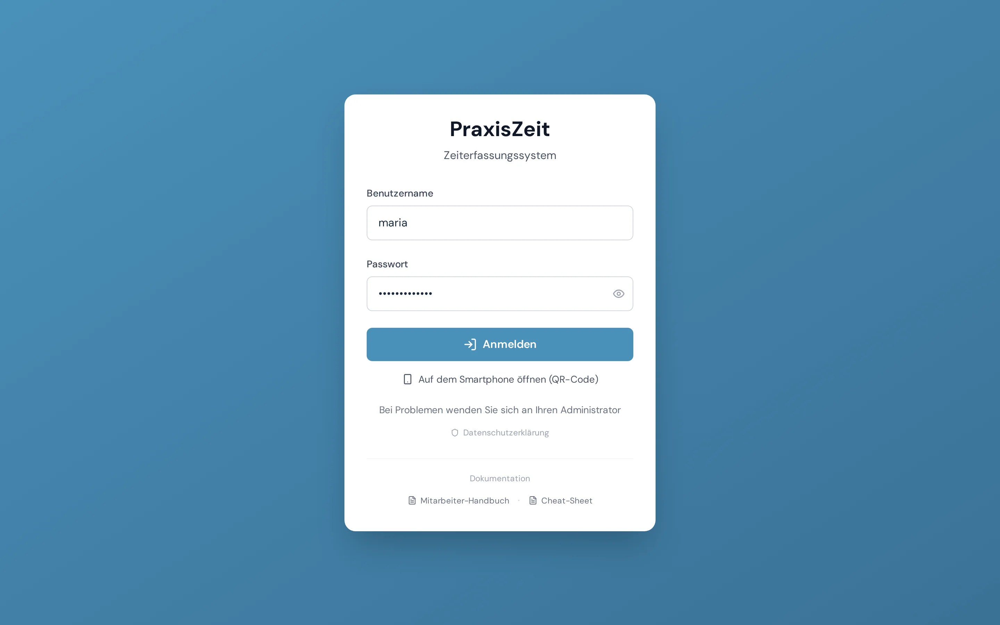

1. Geben Sie Ihren **Benutzernamen** ein.
2. Geben Sie Ihr **Passwort** ein. Das Auge rechts im Feld zeigt es zur Kontrolle an.
3. Klicken Sie auf `Anmelden`. Sie landen auf dem Dashboard.

> **Gut zu wissen:** **Passwort vergessen?** Wenden Sie sich an Ihre Verwaltung. Achten Sie beim Eintippen auf Groß- und Kleinschreibung und die Feststelltaste.

### Wie melde ich mich mit Zwei-Faktor-Code an?

Nur wenn Sie die Zwei-Faktor-Authentifizierung (2FA) in Ihrem Profil eingeschaltet haben. Dann brauchen Sie zusätzlich den wechselnden 6-stelligen Code aus Ihrer Authenticator-App.

1. Geben Sie wie gewohnt Benutzername und Passwort ein und klicken Sie auf `Anmelden`.
2. Es erscheint das Feld `2FA-Code (Authenticator-App)`. Öffnen Sie Ihre Authenticator-App und tippen Sie den 6-stelligen Code ab.
3. Klicken Sie erneut auf `Anmelden`.

> **Achtung:** **Handy verloren?** Die Verwaltung setzt Ihre 2FA zurück. Danach melden Sie sich nur mit dem Passwort an und richten 2FA im Profil neu ein.

### Was erscheint beim ersten Anmelden?

Beim allerersten Anmelden begrüßt Sie PraxisZeit in der Regel mit einem kurzen Überblick – sofern Ihre Praxis das eingeschaltet hat.

1. Das Fenster `Willkommen bei PraxisZeit` zeigt, was Sie in Zeiterfassung, Abwesenheiten, Änderungsanträgen und Profil tun können.
2. Klicken Sie auf `Los geht's`. Das Fenster erscheint danach nicht wieder.

### Wo finde ich was?

Am PC steht die Navigation links. Auf dem Smartphone liegt sie unten am Bildschirmrand.

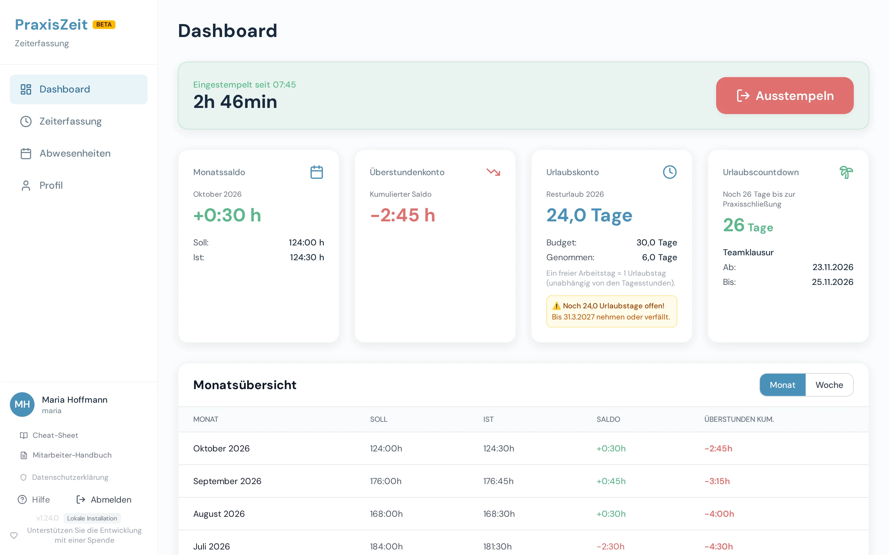

1. `Dashboard`: Ihre Stempelkarte, Saldo und Urlaubskonto auf einen Blick.
2. `Zeiterfassung`: Ihre Zeiteinträge, das Journal und Ihre Anträge.
3. `Abwesenheiten`: Teamkalender, Urlaub und andere Abwesenheiten eintragen.
4. `Profil`: Ihre Daten, Ihre Arbeitszeit, Passwort und 2FA.

> **Gut zu wissen:** Unten links in der Seitenleiste: `Hilfe` öffnet die Hilfe zur aktuellen Seite; darüber stehen `Mitarbeiter-Handbuch` und `Cheat-Sheet`. `Abmelden` beendet Ihre Sitzung.

## Dashboard: Saldo, Urlaub, heute

*Das Dashboard ist Ihre Startseite. Es zeigt, ob Sie gerade eingestempelt sind, wie Ihr Saldo steht und wie viele Urlaubstage Ihnen noch bleiben.*

### Was zeigt mir das Dashboard?

1. **Stempelkarte:** ob Sie eingestempelt sind, seit wann und wie lange Sie heute schon arbeiten.
2. **Monatssaldo:** Soll und Ist des laufenden Monats. Das Soll zählt nur bis zum letzten abgeschlossenen Arbeitstag – heute zählt mit, sobald Sie ausgestempelt haben.
3. **Überstundenkonto:** Ihr kumulierter Saldo über alle Monate.
4. **Urlaubskonto:** Budget, genommene und verbleibende Urlaubstage.
5. **Urlaubscountdown:** Tage bis zu Ihrem nächsten Urlaub oder zur nächsten Praxisschließung, an der Sie teilnehmen – das frühere Datum zählt.

> **Gut zu wissen:** Stunden stehen als Stunden:Minuten, z. B. **8:30** für 8 Stunden 30 Minuten. Ein Minus wie **-2:15** heißt: weniger gearbeitet als das Soll. Grün sind Plusstunden, rot Minusstunden.

> **Achtung:** **Gelber Hinweis im Urlaubskonto:** Im letzten Quartal erinnert PraxisZeit an offenen Urlaub, sobald noch mindestens ein ganzer Urlaubstag offen ist – mit dem Datum, bis wann Sie ihn nehmen sollten.

> **Achtung:** **Roter Kasten „Buchung fehlt“:** Er nennt zwei Fälle. „kein Eintrag“: An einem vergangenen Arbeitstag des laufenden Monats steht weder ein Zeiteintrag noch eine Abwesenheit – Feiertage und Tage ohne Tagessoll zählen nicht. Tragen Sie den Tag per Antrag nach, siehe [Vergangenen Tag nachtragen](#vergangenen-tag-nachtragen). „offen seit …“: Ein Eintrag eines früheren Tages hat noch kein Ende. Tragen Sie das Ende per [Änderungsantrag](#aenderungsantrag-stellen) nach.

### Wie sehe ich meinen Saldo je Monat oder je Woche?

Unter den Kacheln steht die Monatsübersicht, die neueste Zeile oben.

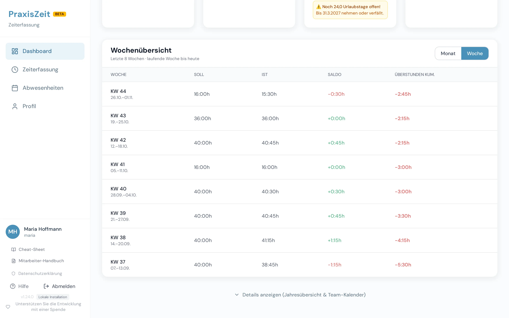

1. Schalten Sie mit `Monat` und `Woche` um. Die Wochenansicht zeigt die letzten 8 Kalenderwochen; Ihre Wahl merkt sich der Browser.
2. **Saldo** je Zeile: Ist minus Soll. So fällt sofort auf, wenn in einer Woche etwas fehlt – etwa ein vergessener Eintrag.
3. **Überstunden kum.**: der Stand Ihres Überstundenkontos am Ende des Monats bzw. der Woche.

> **Gut zu wissen:** Wie sich Soll, Ist und Saldo zusammensetzen, steht unter [So rechnet PraxisZeit: Monatssoll und Saldo „bis heute“](SO-RECHNET-PRAXISZEIT.md#monatssaldo).

### Wo sehe ich mein Jahr und die Abwesenheiten im Team?

Klicken Sie unter der Tabelle auf `Details anzeigen (Jahresübersicht & Team-Kalender)`.

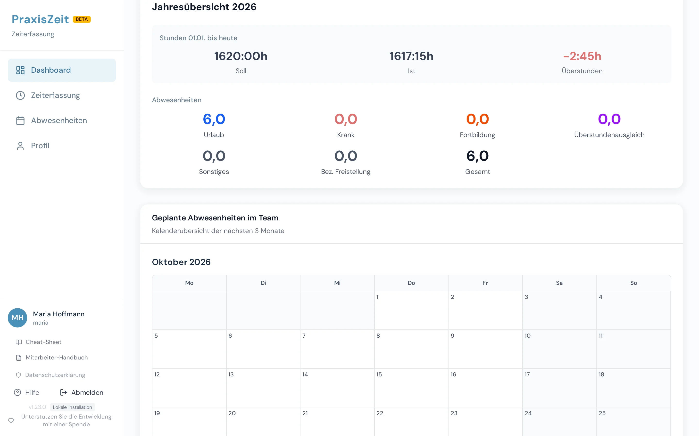

1. **Stunden 01.01. bis heute:** Soll, Ist und Überstunden seit Jahresbeginn.
2. **Abwesenheiten:** Ihre Tage im laufenden Jahr nach Art – Urlaub, Krank, Fortbildung, Überstundenausgleich, Sonstiges.
3. **Geplante Abwesenheiten im Team:** wer in den nächsten 3 Monaten fehlt.

> **Gut zu wissen:** **Keine Stundenzählung für Sie?** Dann fehlen die Stempelkarte mit der Tagesanzeige („x von y h heute“), Monatssaldo und Überstundenkonto – das ist so eingestellt und kein Fehler. Ihr Urlaubskonto wird trotzdem geführt.

> **Gut zu wissen:** **Hinweis zu Ihrer Arbeitszeit:** Ändert die Verwaltung Ihre Arbeitszeit, steht 30 Tage lang ein Kasten mit der Änderung auf dem Dashboard. Der Link `Arbeitszeit im Profil ansehen` führt zu den Details.

## Zeiterfassung: stempeln, Pause, Einträge, Journal

*Am einfachsten erfassen Sie Ihre Zeit live: morgens einstempeln, abends ausstempeln und die Pause eintragen. Jeder Stempel wird zu einem **Zeiteintrag**.*

### Wie stempele ich ein?

Die Stempelkarte steht oben auf dem Dashboard.

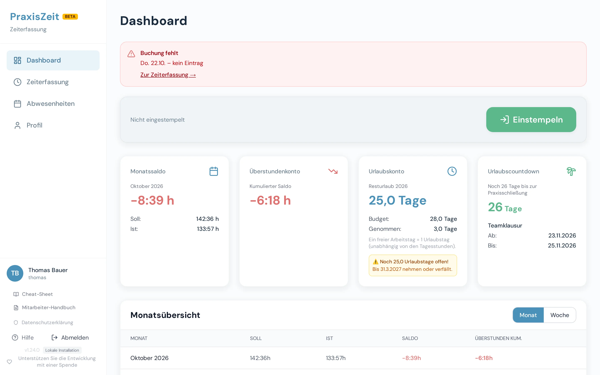

1. Steht dort `Nicht eingestempelt`, läuft gerade keine Uhr.
2. Klicken Sie auf `Einstempeln`. Die Uhr läuft und zeigt Ihre heutige Arbeitszeit.

### Wie stempele ich aus und trage die Pause ein?

Klicken Sie auf der Stempelkarte auf `Ausstempeln`. Daneben erscheint das Pausenfeld.

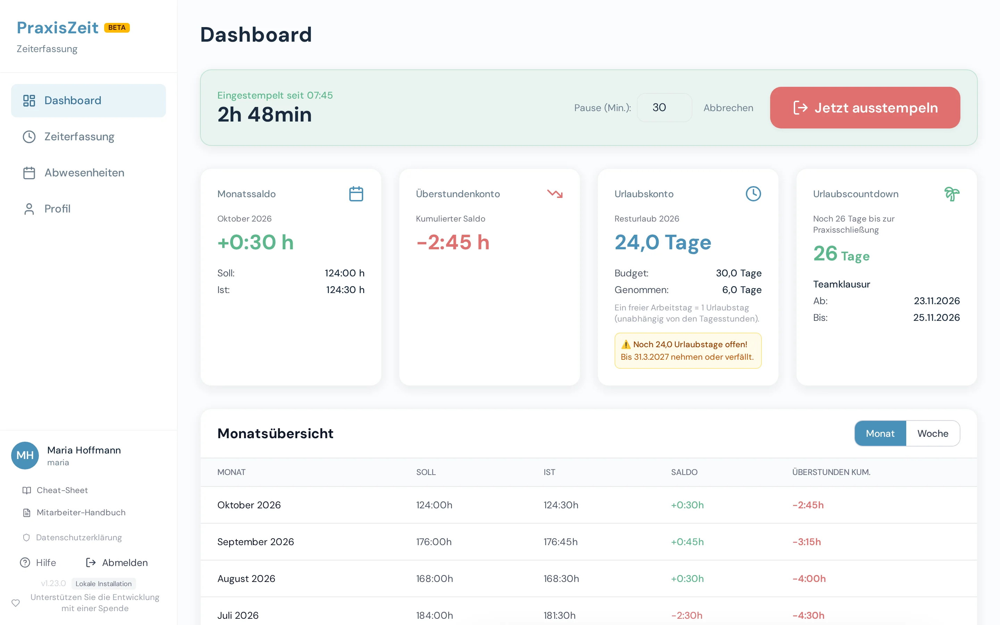

1. Tragen Sie in `Pause (Min.)` ein, wie viele Minuten Pause Sie heute gemacht haben, z. B. 30.
2. Klicken Sie auf `Jetzt ausstempeln`.
3. Verklickt? `Abbrechen` schließt das Pausenfeld, die Uhr läuft weiter.

> **Achtung:** **Pflicht-Pause (§ 4 ArbZG):** Bei mehr als 6 Stunden am Tag mindestens 30 Minuten, bei mehr als 9 Stunden mindestens 45 Minuten. Es zählen alle Einträge des Tages zusammen; eine Unterbrechung gilt erst ab 15 Minuten als Pause. Reicht die Pause nicht, tragen Sie sie nach – oder begründen, warum sie nicht möglich war (mindestens 10 Zeichen), sofern Ihre Praxis diese Ausnahme erlaubt.

> **Gut zu wissen:** **Vergessen auszustempeln?** PraxisZeit schließt einen offenen Eintrag eines früheren Tages automatisch. Die Stempelkarte bietet dann `Arbeitsende per Antrag nachtragen` an – tragen Sie dort Ihr tatsächliches Ende ein.

> **Gut zu wissen:** **Automatisch geschlossen:** Das 23:59, das PraxisZeit dabei setzt, ist kein Stempel; angerechnet wird nur bis zum Ende Ihres letzten Blocks plus Puffer. Im Antrag steht zunächst das angerechnete Ende (z. B. 18:15) – ersetzen Sie es durch Ihr tatsächliches. Auch ein tatsächliches Ende um **23:59**, z. B. nach einem Notdienst, können Sie eintragen: Es gilt dann als echter Stempel und wird wie jedes Ende an Ihren Blöcken gekürzt; bis 23:59 angerechnet wird es, wenn die Verwaltung den Eintrag anerkennt. **Ausnahmen:** Hat das automatische Schließen bei Ihnen nichts gekappt (keine Arbeitszeit-Blöcke, Wochenende oder Feiertag, keine Stundenzählung), steht als Ende schon 23:59; ein erneut gespeichertes 23:59 lässt sich dann nicht vom automatischen Wert unterscheiden, und die Kennzeichnung bleibt. An einem Werktag ohne Block zählt der automatisch geschlossene Eintrag 0 h. Ebenso bleibt die Kennzeichnung, wenn Sie genau das angerechnete Ende (z. B. 18:15) eintragen – dann fehlt weiter das tatsächliche Ende. Anerkennen kann die Verwaltung einen solchen Eintrag erst, wenn das tatsächliche Ende eingetragen ist.

### Wo sehe ich meine Zeiteinträge?

Klicken Sie in der Navigation auf `Zeiterfassung`.

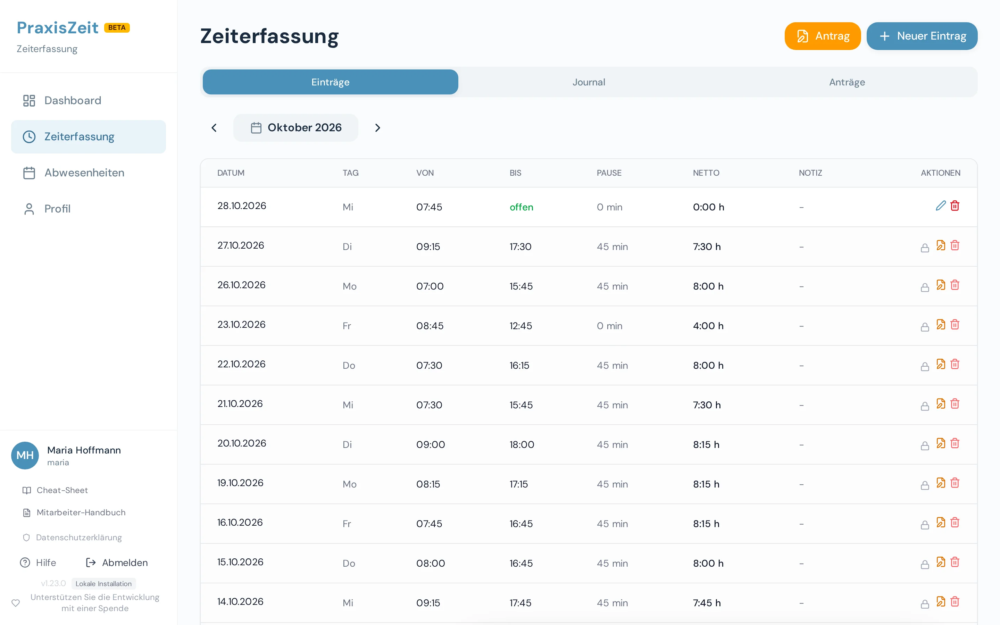

1. Der Tab `Einträge` listet alle Zeiteinträge des Monats, der neueste oben. Ein laufender Eintrag steht als **offen** da.
2. Mit den Pfeilen neben dem Monatsnamen blättern Sie zwischen den Monaten.
3. **Netto** ist die angerechnete Arbeitszeit nach Abzug der Pause.
4. Unter **Aktionen** bearbeiten (Stift) oder löschen (Papierkorb) Sie heutige Einträge selbst. Ältere Einträge sind gesperrt (Schloss); für sie stellen Sie einen Änderungs- oder Löschantrag.

### Wie trage ich die Zeit für heute von Hand ein?

Haben Sie heute nicht gestempelt, klicken Sie oben rechts auf `Neuer Eintrag`. Das Formular erscheint über der Liste, das **Datum** ist mit heute vorbelegt.

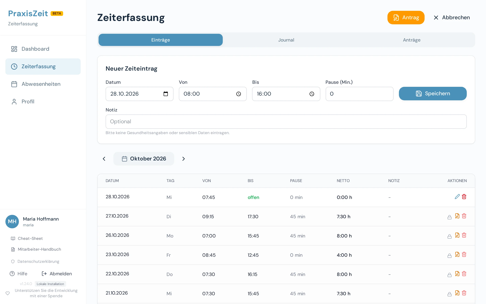

1. **Von:** Ihr Arbeitsbeginn, z. B. 08:00.
2. **Bis:** Ihr Arbeitsende. Es darf nicht in der Zukunft liegen – tragen Sie nur bereits geleistete Zeit ein.
3. **Pause (Min.):** Ihre Pause in Minuten, z. B. 30. Unter **Notiz** können Sie etwas anmerken (keine Gesundheitsangaben).
4. Klicken Sie auf `Speichern`.

> **Gut zu wissen:** Einträge desselben Tages dürfen sich nicht überschneiden; aneinanderstoßende Zeiten wie 08:00–12:00 und 12:00–13:00 sind erlaubt. Ist ein Eintrag länger als 6 Stunden und ohne Pause, schlägt das Formular eine Pause vor.

### Ich habe vergessen zu stempeln – wie trage ich einen vergangenen Tag nach?

Vergangene Tage tragen Sie nicht selbst ein, Sie beantragen sie. Klicken Sie in der Zeiterfassung oben rechts auf `Antrag` (links neben `Neuer Eintrag`).

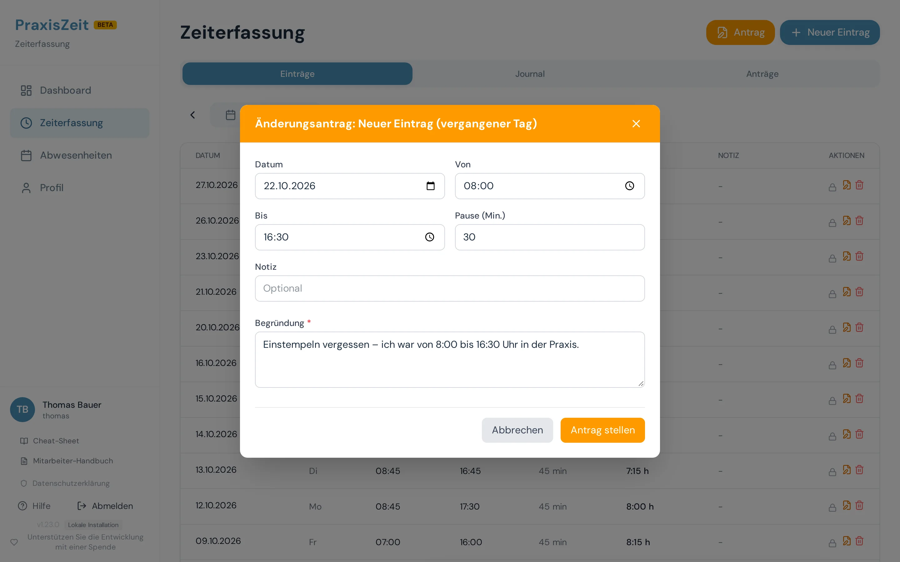

1. Wählen Sie das **Datum** des vergessenen Tages.
2. Tragen Sie **Von**, **Bis** und **Pause (Min.)** ein.
3. Schreiben Sie eine **Begründung** – sie ist Pflicht.
4. Klicken Sie auf `Antrag stellen`. Die Verwaltung prüft den Antrag; den Stand sehen Sie unter Zeiterfassung → Tab `Anträge`.

> **Gut zu wissen:** Im **Journal** geht es auch über das **+** in der Zeile des Tages. Fehlt an einem vergangenen Werktag ein Eintrag, zeigt das Dashboard oben den roten Kasten „Buchung fehlt“ mit dem Tag und dem Link `Zur Zeiterfassung →`.

### Warum wird ein Teil meiner Zeit nicht angerechnet?

Hat Ihre Praxis **Arbeitszeit-Blöcke** für Sie hinterlegt, wird nur die Zeit innerhalb der Blöcke angerechnet – mit einem Puffer (Standard 15 Minuten) an jedem Blockrand. Ihre Blöcke stehen im Profil unter „Meine Arbeitszeit“.

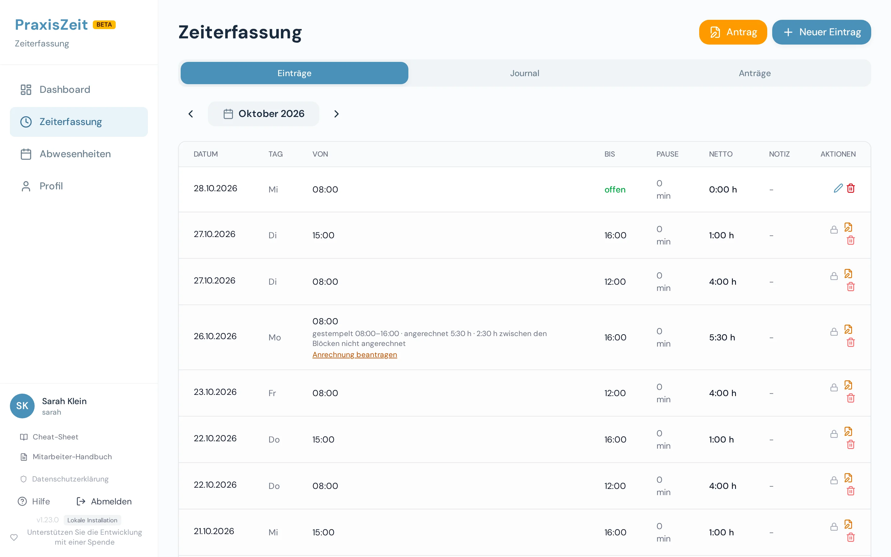

1. In der Zeile des Eintrags steht unter der Uhrzeit eine Zusatzzeile, z. B. „gestempelt 08:00–16:00 · angerechnet 5:30 h · 2:30 h zwischen den Blöcken nicht angerechnet“. Ihre gestempelte Zeit bleibt gespeichert.
2. Haben Sie in dieser Zeit gearbeitet, klicken Sie darunter auf `Anrechnung beantragen`, begründen Sie kurz und senden Sie den Antrag ab. Die Verwaltung entscheidet.

> **Gut zu wissen:** **Nicht angerechnet heißt nicht unbezahlt.** Ob gearbeitete Zeit vergütet wird, entscheidet nicht diese Anrechnung. Maßgeblich ist, ob die Arbeit angeordnet, gebilligt oder geduldet war (§ 611a, § 612 BGB). Sprechen Sie Ihre Verwaltung an oder beantragen Sie die Anrechnung. Hat Ihre Praxis gar keine Blöcke für Sie hinterlegt, zählt Ihre gestempelte Zeit ganz normal. Mehr dazu: [So rechnet PraxisZeit: Arbeitszeit-Blöcke und Kappung](SO-RECHNET-PRAXISZEIT.md#bloecke-kappung).

> **Achtung:** **Werktag ohne Block = freier Tag:** Sind Blöcke für Sie hinterlegt und haben Sie an einem Werktag (Mo–Fr) keinen Block, stempeln dort aber trotzdem, wird die Zeit gespeichert, aber mit **0 Stunden** angerechnet – auch ein vergessenes Ausstempeln. Haben Sie gearbeitet, beantragen Sie die Anrechnung über `Anrechnung beantragen`; angerechnet wird erst, wenn die Verwaltung den Antrag genehmigt und anerkennt oder den Eintrag anerkennt. Am Wochenende und an Feiertagen gelten keine Blöcke – dort wird die ganze Zeit angerechnet.

> **Gut zu wissen:** **Pause und Lücke:** Die Lücke zwischen zwei Blöcken zählt für die Pausenpflicht (§ 4 ArbZG) als Pause, sobald nach Abzug des Puffers an beiden Rändern mindestens 15 Minuten übrig bleiben. Das gilt nur, wenn sie tatsächlich frei war: Haben Sie ohne Pause durchgestempelt, erinnert „Durchgehend über die Lücke zwischen den Arbeitsblöcken gestempelt – eine Ruhepause ist nicht erfasst“ daran. Tragen Sie dagegen eine Pause ein, obwohl Sie über die Lücke durchgestempelt haben, wird beides abgezogen („Pause in der Lücke wird zusätzlich abgezogen: …“); lag die Pause in der Lücke, setzen Sie die Pause auf 0.

### Wie sehe ich meinen Monat Tag für Tag?

Das Journal zeigt jeden Tag des Monats – Arbeitstage, Wochenenden, Feiertage und Abwesenheiten.

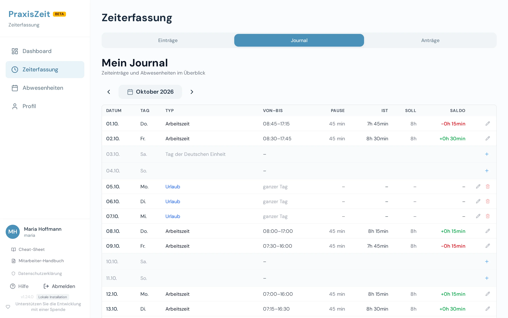

1. Klicken Sie in der Zeiterfassung auf den Tab `Journal`.
2. Je Tag stehen Art, Von–Bis, Pause, Ist und Soll; **Saldo** ist die Differenz des Tages.
3. Mit den Pfeilen neben dem Monatsnamen blättern Sie zwischen den Monaten.

## Urlaub & Abwesenheit: Kalender, Antrag, Halbtag

*Urlaub, Krankheit, Fortbildung: Abwesenheiten tragen Sie unter **Abwesenheiten** ein. Verlangt Ihre Praxis eine Genehmigung, wird aus dem Urlaub ein Antrag an die Verwaltung.*

### Wer ist wann abwesend?

Klicken Sie in der Navigation auf `Abwesenheiten`. Der Tab `Kalender` zeigt die Abwesenheiten des ganzen Teams: je Person ein Kreis mit ihrem Kürzel – der Ring ist die Farbe der Person, die Mitte die Art der Abwesenheit.

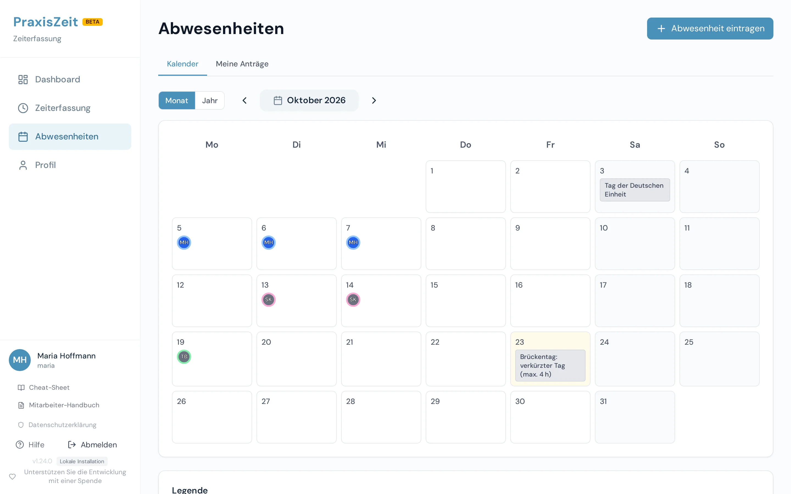

1. Mit `Monat` und `Jahr` wechseln Sie die Ansicht.
2. Mit den Pfeilen neben dem Monatsnamen blättern Sie weiter. Die **Legende** unter dem Kalender erklärt die Farben.

> **Gut zu wissen:** **Datenschutz:** Bei Kolleginnen und Kollegen sehen Sie nur Urlaub und Fortbildung mit ihrer Art. Krankheit, bezahlte Freistellung, Sonstiges und eigene Gründe der Praxis erscheinen neutral als **Abwesend**. Ihre eigenen Abwesenheiten sehen Sie immer mit der echten Art.

> **Gut zu wissen:** **Verkürzte Tage und Sondertage:** Ein verkürzter Tag steht im Kalender z. B. als „Brückentag: verkürzter Tag (max. 4 h)“. An diesem Tag ist Ihr Tagessoll höchstens so hoch wie angegeben, Urlaub kostet einen halben Tag. Mehr dazu: [So rechnet PraxisZeit: Sondertage und verkürzte Tage](SO-RECHNET-PRAXISZEIT.md#sondertage).

### Wie trage ich Urlaub oder eine andere Abwesenheit ein?

Klicken Sie oben rechts auf `Abwesenheit eintragen`.

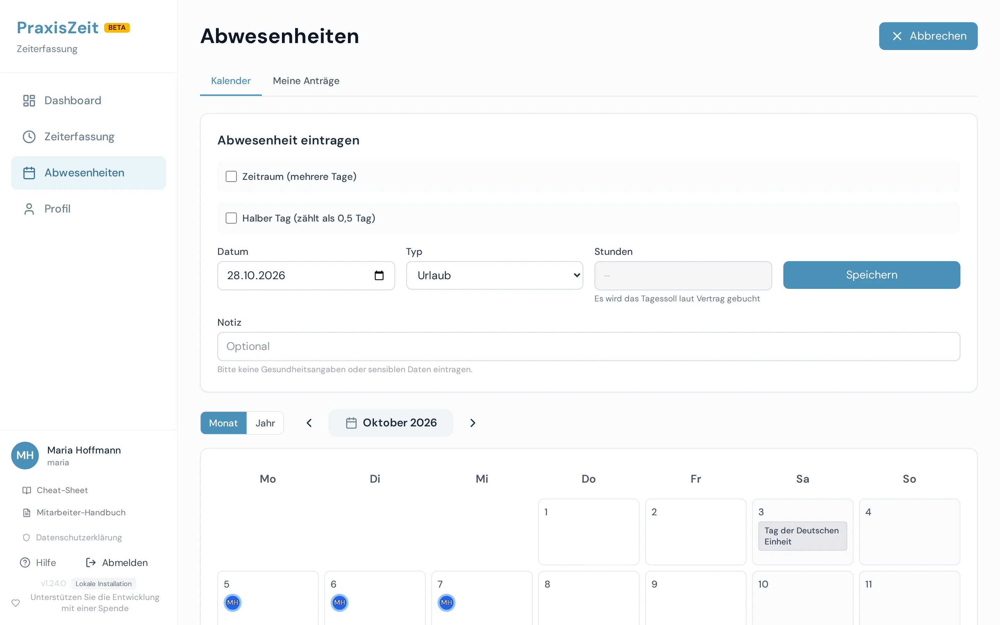

1. Mehrere Tage? Setzen Sie den Haken bei `Zeitraum (mehrere Tage)`. Wochenenden, Feiertage und Ihre freien Tage werden ausgelassen.
2. Wählen Sie das **Datum** – beim Zeitraum **Von** und **Bis**.
3. Wählen Sie den **Typ**: Urlaub, Krank, Fortbildung (außer Haus), Überstundenausgleich, Sonstiges – oder einen eigenen Grund Ihrer Praxis.
4. Das Feld **Stunden** bleibt ausgegraut: Gebucht wird Ihr Tagessoll laut Vertrag („Es wird das Tagessoll laut Vertrag gebucht“). Nur beim Überstundenausgleich können Sie es ausfüllen.
5. Klicken Sie auf `Speichern`. Urlaubstage gehen automatisch von Ihrem Budget ab – verlangt Ihre Praxis eine Genehmigung, erst nachdem die Verwaltung den Antrag genehmigt hat.

> **Gut zu wissen:** **Stunden** sind bei allen Arten außer **Überstundenausgleich** gesperrt – gebucht wird Ihr Tagessoll. Beim Überstundenausgleich zählt der eingetragene Wert und wird von Ihrem Überstundenkonto abgezogen; haben Sie einen Tagesplan, bucht das System stattdessen das Tagessoll des Tages.

> **Achtung:** **Vergangene Tage nur per Antrag:** Liegt das Datum in der Vergangenheit, ist `Speichern` gesperrt. Stellen Sie den Antrag in Zeiterfassung → `Journal` über das **+** in der Zeile des Tages und wählen Sie dort die Art, z. B. Krank für gestern. Das **+** steht an vergangenen Tagen ohne Eintrag und ohne Abwesenheit.

> **Achtung:** **Tag mit anerkanntem Zeiteintrag:** Liegt an einem der Tage ein Zeiteintrag, den die Verwaltung anerkannt hat, lehnt PraxisZeit die Buchung ab und nennt den Tag, z. B. „Am 05.10.2026 gibt es einen anerkannten Zeiteintrag – bitte an die Verwaltung wenden.“ Die Verwaltung trägt die Abwesenheit für diesen Tag ein; die übrigen Tage können Sie getrennt buchen.

### Wie nehme ich einen halben Tag Urlaub?

Wie oben über `Abwesenheit eintragen` – für einen einzelnen Tag.

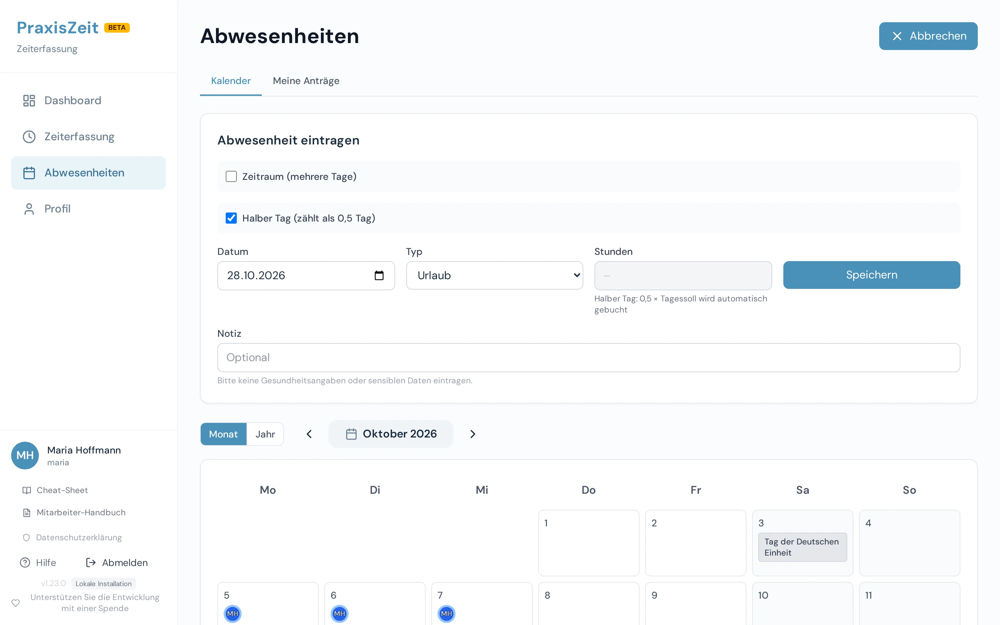

1. Setzen Sie den Haken bei `Halber Tag (zählt als 0,5 Tag)`. Er steht nur bei einem einzelnen Tag bereit, nicht bei Krank oder Überstundenausgleich.
2. Das Feld **Stunden** bleibt ausgegraut („Halber Tag: 0,5 × Tagessoll wird automatisch gebucht“): Gebucht wird das halbe Tagessoll.
3. Wählen Sie Datum und Typ und klicken Sie auf `Speichern`. Vom Urlaubskonto gehen 0,5 Tage ab.

### Wie stelle ich einen Urlaubsantrag, und wo sehe ich, ob er genehmigt ist?

Verlangt Ihre Praxis eine Genehmigung für Urlaub, tragen Sie ihn wie oben ein. Nach `Speichern` erscheint „Urlaubsantrag gestellt“, und die Seite wechselt zum Tab `Meine Anträge`.

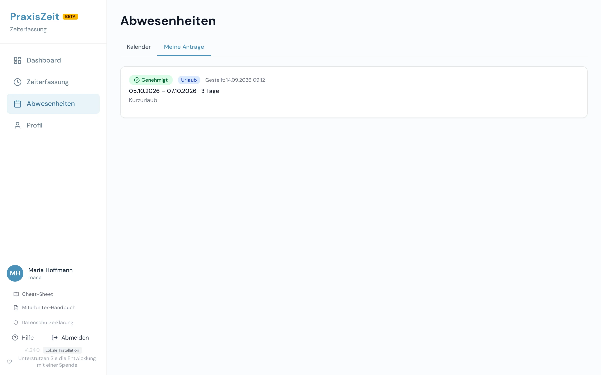

1. Unter `Meine Anträge` stehen alle Ihre Urlaubsanträge.
2. Jeder Antrag steht als Karte mit seinem Status – **Offen**, **Genehmigt**, **Abgelehnt** (mit Ablehnungsgrund) oder **Zurückgezogen** – und dem Datum, an dem er gestellt wurde.
3. Neben dem Zeitraum steht, wie viele Tage der Antrag kostet. Es zählen nur Ihre Arbeitstage; ein halber Tag zählt 0,5.

> **Gut zu wissen:** **Zurückziehen oder stornieren:** Unter `Meine Anträge` steht neben einem offenen Antrag das Löschen-Symbol `Antrag zurückziehen`, neben einem genehmigten Urlaub, der noch nicht begonnen hat, `Urlaub stornieren`. Bestätigen Sie jeweils im Dialog.

### Wie lösche ich eine eingetragene Abwesenheit?

Unter dem Kalender stehen Ihre Abwesenheiten des Jahres als Liste. Was in der Spalte **Aktionen** steht, hängt vom Tag ab.

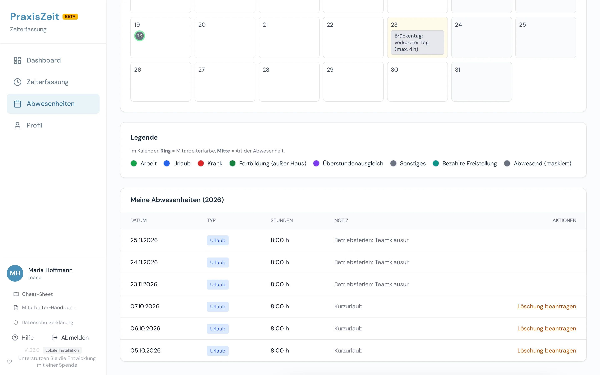

1. **Heute oder später:** Klicken Sie in der Zeile auf `Löschen` und bestätigen Sie im Dialog.
2. **Vergangener Tag:** Dort steht `Löschung beantragen`. Es öffnet sich der Dialog „Änderungsantrag: Löschung beantragen“ mit der Abwesenheit.
3. Geben Sie die **Begründung** an und klicken Sie auf `Antrag stellen`. Erst wenn die Verwaltung genehmigt, wird die Abwesenheit gelöscht; den Stand sehen Sie unter Zeiterfassung → Tab `Anträge`.

> **Gut zu wissen:** Im **Journal** geht es genauso: Neben der Abwesenheit eines vergangenen Tages steht der Papierkorb **Löschung beantragen**.

> **Achtung:** **Betriebsferien-Tage** ändert nur die Verwaltung – dort steht kein Knopf. Genehmigten Urlaub, der noch nicht begonnen hat, nehmen Sie mit `Urlaub stornieren` unter `Meine Anträge` zurück. Ebenfalls nicht selbst löschen können Sie Urlaub bei eingeschalteter Genehmigungspflicht, Abwesenheiten, die die Verwaltung für Sie eingetragen hat, und Tage eines abgeschlossenen Jahres – wenden Sie sich dann an Ihre Verwaltung.

> **Gut zu wissen:** **So zählt Urlaub:** Ein freier Arbeitstag ist genau 1 Urlaubstag – egal, wie viele Stunden Sie an dem Tag arbeiten würden. Eine freie Woche kostet so viele Tage, wie Sie Arbeitstage pro Woche haben. **Betriebsferien** trägt PraxisZeit automatisch für Sie ein. Mehr dazu: [So rechnet PraxisZeit: Urlaubskonto](SO-RECHNET-PRAXISZEIT.md#urlaubskonto) und [So rechnet PraxisZeit: Betriebsferien](SO-RECHNET-PRAXISZEIT.md#betriebsferien).

## Anträge: Korrektur, Löschung, Status, zurückziehen

*Heutige Zeiteinträge ändern Sie selbst. Ab dem nächsten Tag ist ein Eintrag gesperrt – dann beantragen Sie die Korrektur oder Löschung, und die Verwaltung entscheidet. So bleibt jede Änderung nachvollziehbar (§ 16 ArbZG).*

### Wann brauche ich einen Antrag?

In Zeiterfassung → Tab `Einträge` zeigt die Spalte **Aktionen**, was Sie tun können: Bei heutigen Einträgen stehen Stift und Papierkorb – Sie bearbeiten oder löschen selbst. Bei älteren Einträgen steht ein Schloss, daneben zwei Antragsknöpfe.

1. **Änderungsantrag stellen** (Blatt mit Stift): Zeiten, Pause oder Datum eines gesperrten Eintrags korrigieren.
2. **Löschantrag stellen** (Papierkorb neben dem Schloss): einen gesperrten Eintrag ganz entfernen lassen.

> **Gut zu wissen:** Ganz vergessen zu stempeln? Für einen vergangenen Tag ohne Eintrag gibt es oben rechts den Knopf `Antrag` – siehe [Vergangenen Tag nachtragen](#vergangenen-tag-nachtragen).

### Wie korrigiere ich einen älteren Eintrag?

Klicken Sie in der Zeile des Eintrags auf **Änderungsantrag stellen**. Es öffnet sich der Dialog „Änderungsantrag: Eintrag ändern“.

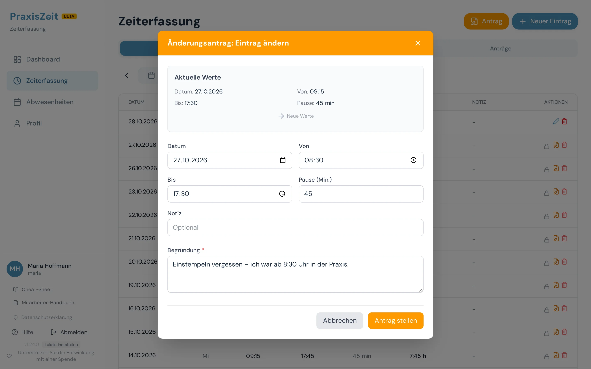

1. **Aktuelle Werte** zeigt, was heute gespeichert ist.
2. Darunter tragen Sie die richtigen Werte ein: **Datum**, **Von**, **Bis**, **Pause (Min.)** und bei Bedarf eine **Notiz**. Im Beispiel wird nur der Beginn korrigiert.
3. Schreiben Sie eine **Begründung** – sie ist Pflicht.
4. Klicken Sie auf `Antrag stellen`. Der Eintrag bleibt unverändert, bis die Verwaltung den Antrag genehmigt.

> **Achtung:** **Pflicht-Pause nicht möglich? (§ 4 ArbZG)** Erfüllen die neuen Zeiten die Pausenregel nicht, erscheint das Feld `Pflicht-Pause war nicht möglich – Begründung`. Begründen Sie dort (mindestens 10 Zeichen) und senden Sie mit `Mit dokumentierter Ausnahme senden`. Hat Ihre Praxis diese Ausnahme abgeschaltet, fehlt das Feld – tragen Sie dann die Pause ein.

> **Gut zu wissen:** **Sonn- oder Feiertag (§ 10 ArbZG):** Liegt das Datum auf einem Sonntag oder Feiertag, fragt der Antrag zusätzlich nach dem `Ausnahmegrund (§10 ArbZG)`, z. B. „Notdienst“. Er wird mit der Genehmigung am Eintrag gespeichert.

### Wie lasse ich einen falschen Eintrag löschen?

Klicken Sie in der Zeile des Eintrags auf **Löschantrag stellen**. Es öffnet sich der Dialog „Änderungsantrag: Eintrag löschen“.

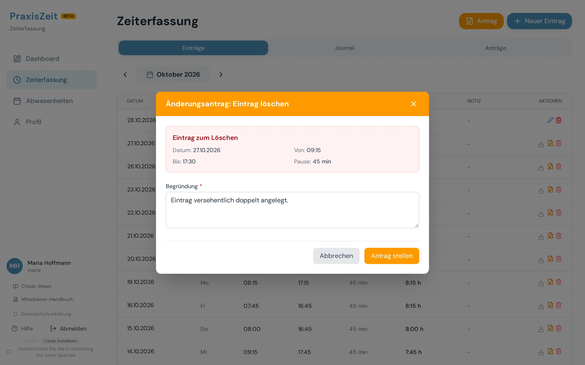

1. **Eintrag zum Löschen** zeigt Datum, Von, Bis und Pause des Eintrags. Prüfen Sie, ob es der richtige ist.
2. Schreiben Sie eine **Begründung**.
3. Klicken Sie auf `Antrag stellen`. Gelöscht wird erst, wenn die Verwaltung genehmigt.

> **Gut zu wissen:** **Heutiger Eintrag am falschen Tag?** Beim Bearbeiten bleibt das Datum fest. Löschen Sie den heutigen Eintrag und beantragen Sie den richtigen Tag über den Knopf `Antrag`.

> **Gut zu wissen:** **Schloss schon heute?** Dann hat die Verwaltung die ganze gestempelte Zeit dieses Eintrags anerkannt („Anerkannter Eintrag – Änderung per Änderungsantrag oder über die Verwaltung“). Ändern oder löschen Sie ihn auch heute per Antrag.

### Wo sehe ich, ob mein Antrag genehmigt ist – und wie ziehe ich ihn zurück?

Klicken Sie in der Zeiterfassung auf den Tab `Anträge`. Darunter stehen unter **Änderungsanträge** alle Ihre Anträge, der neueste oben.

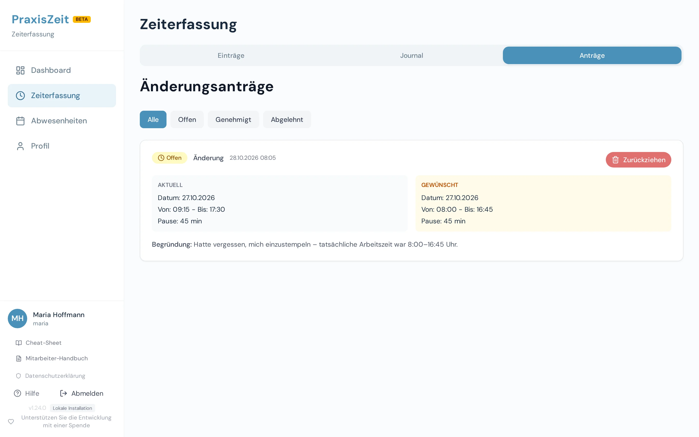

1. Der Tab `Anträge` öffnet die Liste.
2. Mit `Alle`, `Offen`, `Genehmigt` und `Abgelehnt` filtern Sie nach Status.
3. Jeder Antrag ist eine Karte: oben Status (**Offen**, **Genehmigt** oder **Abgelehnt**), Art (**Neuer Eintrag**, **Änderung** oder **Löschung**) und wann Sie ihn gestellt haben; darunter **Aktuell** und **Gewünscht** sowie Ihre Begründung.
4. Solange ein Antrag **Offen** ist, steht rechts `Zurückziehen`. Bestätigen Sie im Dialog „Antrag zurückziehen“ – der Antrag verschwindet aus der Liste.

> **Gut zu wissen:** Genehmigte oder abgelehnte Anträge lassen sich nicht zurückziehen. Bei einem Antrag aus `Anrechnung beantragen` steht zusätzlich „Anrechnung beantragt“; nach der Genehmigung „anerkannt“ oder „ohne Anerkennen genehmigt“.

### Mein Antrag wurde abgelehnt – warum?

Die Verwaltung gibt bei jeder Ablehnung einen Grund an.

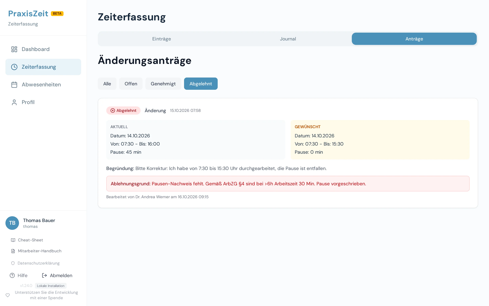

1. Klicken Sie im Tab `Anträge` auf den Filter `Abgelehnt`.
2. Der rote Kasten **Ablehnungsgrund** sagt, was fehlt. Darunter steht, wer den Antrag wann bearbeitet hat.
3. Ist der Grund behoben, stellen Sie einen neuen Antrag – oder sprechen Sie die Verwaltung an.

> **Gut zu wissen:** **Urlaubsanträge** stehen nicht hier, sondern unter Abwesenheiten → `Meine Anträge` – siehe [Urlaubsantrag und Status](#urlaubsantrag-status).

## Auf dem Handy: Stempel-Knopf, untere Leiste

*PraxisZeit läuft auch im Browser Ihres Smartphones – ohne eigene App. Auf dem schmalen Bildschirm sitzt die Navigation unten, und der runde Stempel-Knopf liegt in der Mitte, gut mit dem Daumen erreichbar.*

### Wie finde ich mich auf dem Smartphone zurecht?

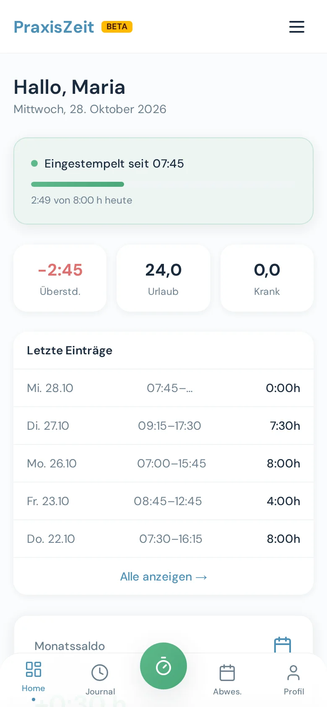

1. Oben rechts öffnet das **Menü** (drei Striche) die ganze Navigation – auch Hilfe, Handbuch und Abmelden.
2. Der runde **Stempel-Knopf** in der Mitte der unteren Leiste öffnet die Stempeluhr. Grün mit Uhr heißt: Sie sind eingestempelt.
3. Die **untere Leiste**: `Home` (Dashboard), `Journal` (Zeiterfassung, Tab Journal), `Abwes.` (Abwesenheiten) und `Profil`.

### Wie stempele ich auf dem Smartphone ein und aus?

Tippen Sie auf den runden Stempel-Knopf. Von unten fährt die Stempeluhr herein.

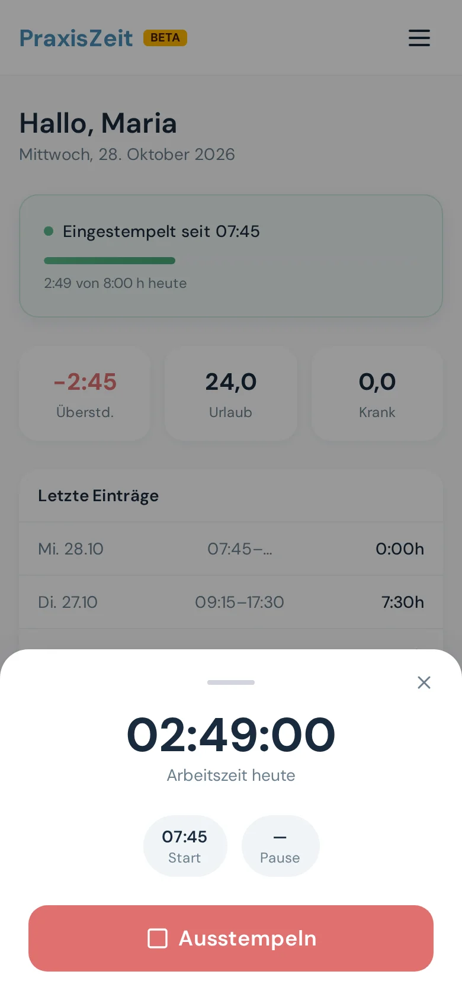

1. Die große Uhr zeigt Ihre **Arbeitszeit heute**, darunter **Start** und **Pause**.
2. Tippen Sie auf `Einstempeln` bzw. `Ausstempeln`. Beim Ausstempeln erscheint das Feld **Pause (Minuten)** – tragen Sie Ihre Pause ein und tippen Sie auf `Jetzt ausstempeln`.
3. `Abbrechen` schließt das Pausenfeld, das **X** oben rechts die Stempeluhr.

> **Gut zu wissen:** Es gelten dieselben Regeln wie am PC – auch die Pflicht-Pause nach § 4 ArbZG, siehe [Ausstempeln mit Pause](#ausstempeln-mit-pause). Führt Ihre Praxis für Sie keine Stundenzählung, fehlt der Stempel-Knopf.

### Wie trage ich auf dem Smartphone Zeiten nach oder korrigiere sie?

Öffnen Sie über das Menü die **Zeiterfassung**. Die Einträge stehen dort als Karten, der neueste oben.

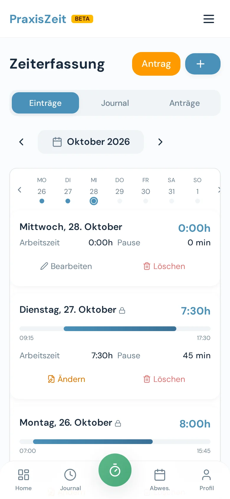

1. `Antrag`: einen vergangenen Tag ohne Eintrag beantragen.
2. Das **Plus** öffnet das Formular für einen neuen Eintrag von heute. Es fährt von unten herein.
3. Bei gesperrten Einträgen (Schloss neben dem Datum) stellt `Ändern` einen Änderungsantrag und `Löschen` einen Löschantrag. Heutige Einträge haben `Bearbeiten` und `Löschen`.

### Wie öffne ich PraxisZeit schnell auf dem Smartphone?

Sie müssen die Adresse nicht abtippen.

1. Öffnen Sie PraxisZeit am PC und klicken Sie auf der Anmeldeseite auf `Auf dem Smartphone öffnen (QR-Code)`.
2. Scannen Sie den QR-Code mit der Kamera Ihres Smartphones. Der Browser öffnet dieselbe Anmeldeseite.
3. Melden Sie sich wie gewohnt mit Benutzername und Passwort an.

> **Gut zu wissen:** Der QR-Code öffnet nur die Seite, er meldet Sie nicht an. Ihr Smartphone muss im selben Netz sein wie der Server (meist das Praxis-WLAN). Bei einem selbst ausgestellten Zertifikat bestätigen Sie die Sicherheitswarnung einmal.

### Kann ich PraxisZeit wie eine App auf den Startbildschirm legen?

Ja, auf unterstützten Geräten.

1. **Android (Chrome):** Menü des Browsers → „Zum Startbildschirm hinzufügen“.
2. **iPhone (Safari):** Teilen-Symbol → „Zum Home-Bildschirm“.

## Profil, Passwort, 2FA

*Im **Profil** stehen Ihre Daten und Ihre Arbeitszeit. Dort ändern Sie Ihr Passwort und schützen Ihr Konto auf Wunsch zusätzlich mit einem Code aus einer Authenticator-App.*

### Was steht in meinem Profil, und was kann ich selbst ändern?

Klicken Sie in der Navigation auf `Profil`.

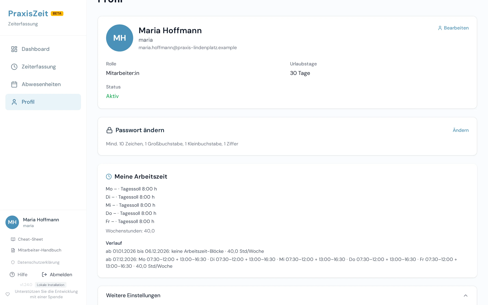

1. `Bearbeiten`: Vorname, Nachname und E-Mail ändern und mit `Speichern` übernehmen. Ein Profilbild setzen Sie per Klick auf das runde Bild.
2. **Passwort ändern** → `Ändern`, siehe unten.
3. **Meine Arbeitszeit**: Ihre heute gültige Arbeitszeit, siehe unten.
4. **Weitere Einstellungen** (aufgeklappt): Zwei-Faktor-Authentifizierung, **Kalenderfarbe** für den Teamkalender und **Meine Daten exportieren** (`JSON herunterladen`).

> **Gut zu wissen:** Benutzername, Rolle, Urlaubstage und Ihre Arbeitszeit legt die Verwaltung fest. Fehlt dort etwas oder stimmt es nicht, sprechen Sie sie an.

### Wo sehe ich meine Arbeitszeit und wann sie sich geändert hat?

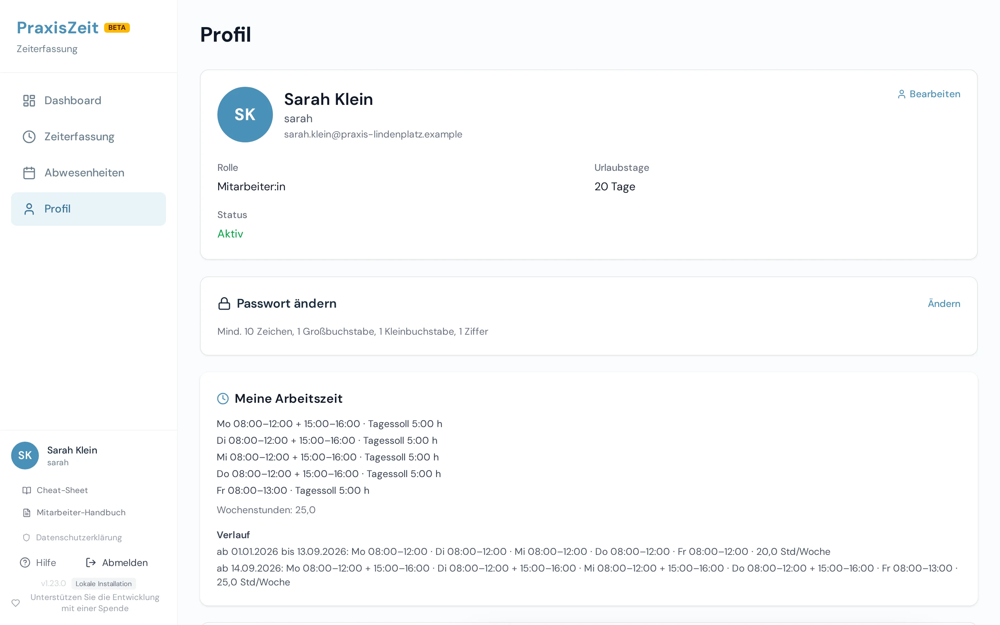

1. Die Karte **Meine Arbeitszeit** im Profil.
2. Je Wochentag Ihre **Arbeitszeit-Blöcke** und Ihr **Tagessoll**, darunter Ihre **Wochenstunden**. Sind keine Blöcke hinterlegt, steht „–“ statt der Zeiten.
3. Der **Verlauf** listet jede Änderung mit dem Datum, ab dem sie gilt.

> **Gut zu wissen:** Ändert die Verwaltung Ihre Arbeitszeit, kündigt das Dashboard es 30 Tage lang an. Arbeiten Sie im Minijob mit fester Monatsarbeitszeit, heißen die Tageswerte „geplant“; ohne Stundenzählung gibt es kein Tagessoll. **Übernommenes Arbeitszeit-Fenster:** Hat Ihre Praxis Ihnen vor Version 1.20.0 ein Arbeitszeit-Fenster hinterlegt, gilt es weiter als ein Block je Tag, bis die Verwaltung es umstellt. Die Karte vermerkt dann: „Diese Zeiten begrenzen nur die Anrechnung der erfassten Zeit; das Tagessoll wird nicht aus ihnen berechnet.“

### Wie ändere ich mein Passwort?

Klicken Sie in der Karte **Passwort ändern** auf `Ändern`.

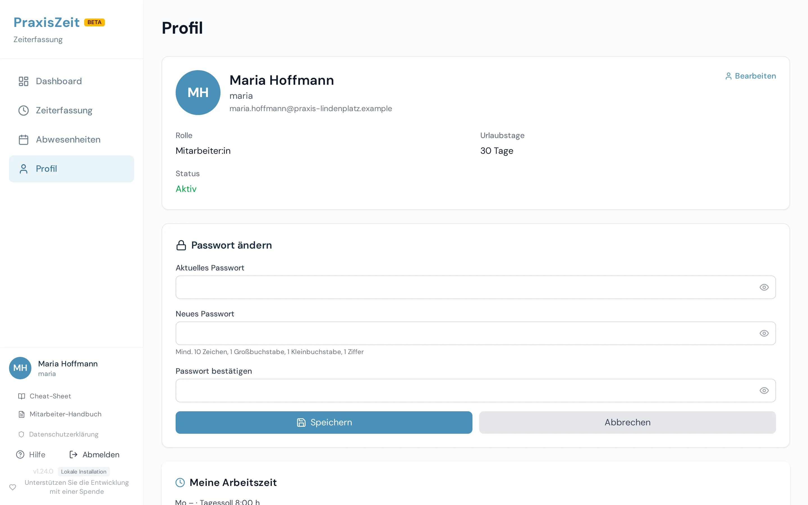

1. **Aktuelles Passwort** eingeben.
2. **Neues Passwort** eingeben: mindestens 10 Zeichen, 1 Großbuchstabe, 1 Kleinbuchstabe, 1 Ziffer.
3. Unter **Passwort bestätigen** das neue Passwort wiederholen.
4. Klicken Sie auf `Speichern`.

> **Gut zu wissen:** Nach dem Ändern bleiben Sie hier angemeldet. Alle anderen Sitzungen – etwa auf dem Smartphone – werden abgemeldet; dort melden Sie sich mit dem neuen Passwort wieder an.

### Wie schütze ich mein Konto mit Zwei-Faktor-Authentifizierung (2FA)?

Sie brauchen eine Authenticator-App auf dem Smartphone, z. B. Google Authenticator oder Authy. Im Profil unter **Weitere Einstellungen** → **Zwei-Faktor-Authentifizierung (2FA)** klicken Sie auf `2FA aktivieren`, bestätigen Ihr aktuelles Passwort und klicken auf `Weiter`.

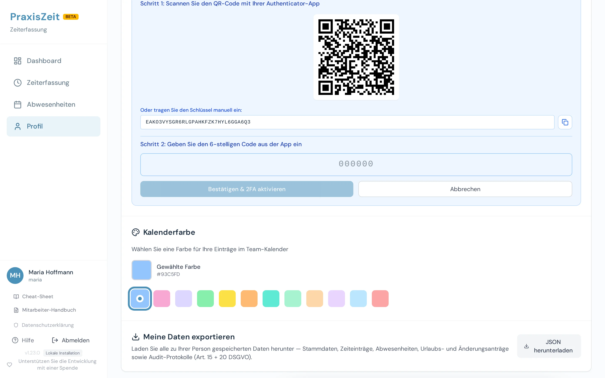

1. Scannen Sie den **QR-Code** mit Ihrer Authenticator-App. Alternativ tippen Sie den Schlüssel darunter in die App ein.
2. Geben Sie den **6-stelligen Code** ein, den die App jetzt anzeigt.
3. Klicken Sie auf `Bestätigen & 2FA aktivieren`. Ab jetzt fragt die Anmeldung nach dem Code, siehe [Anmelden mit 2FA](#anmelden-mit-2fa).

### Wie schalte ich 2FA aus, z. B. vor einem Handywechsel?

Solange 2FA aktiv ist, lässt sie sich nicht neu einrichten. Schalten Sie sie erst mit dem alten Gerät aus.

1. Klicken Sie im Profil unter **Zwei-Faktor-Authentifizierung (2FA)** auf `2FA deaktivieren`.
2. Geben Sie Ihr aktuelles Passwort und den aktuellen 6-stelligen Code aus der App ein.
3. Klicken Sie auf `2FA deaktivieren`. Danach richten Sie 2FA auf dem neuen Gerät neu ein.

> **Achtung:** **Handy verloren?** Dann haben Sie keinen Code mehr. Die Verwaltung setzt Ihre 2FA zurück; danach melden Sie sich nur mit dem Passwort an und richten 2FA neu ein.

## Schichtplan (wenn eingeschaltet)

> **Gut zu wissen:** **Nur wenn eingeschaltet:** Den Schichtplan gibt es nur, wenn Ihre Praxis die Schichtplanung nutzt. Sonst fehlt der Menüpunkt – dieses Kapitel können Sie dann überspringen.

*Der Schichtplan zeigt, wer wann an welchem Arbeitsplatz eingeteilt ist. Er ist ein reines Planungswerkzeug: Ihre Zeiteinträge, Ihr Urlaub und Ihr Überstundenkonto ändern sich dadurch nicht.*

### Wo sehe ich, wann ich wo eingeteilt bin?

Klicken Sie in der Navigation auf `Schichtplan`.

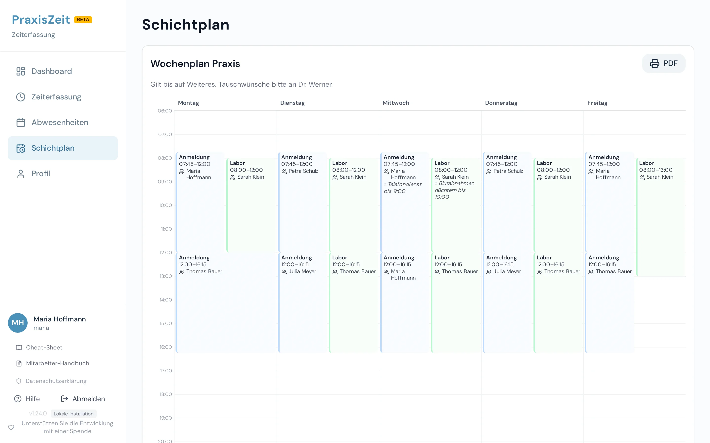

1. Jeder Plan steht mit seinem Namen und seiner Beschreibung über einem Wochenraster: je Tag die Arbeitsplätze mit Uhrzeit und den eingeteilten Personen. Ein **»** vor einem Text ist ein Hinweis zur Einteilung, z. B. „» Telefondienst bis 9:00“.
2. `PDF` erstellt den angezeigten Plan als Aushang zum Ausdrucken.

> **Gut zu wissen:** Gelten heute mehrere Pläne, z. B. einer je Standort, stehen alle untereinander. Hat die Verwaltung einen Plan für später freigegeben, wählen Sie ihn unter „Vorschau — freigegeben, gilt aber (noch) nicht heute:“. Er trägt dann den Hinweis „Dieser Plan gilt noch nicht — er ist zur Ansicht freigegeben.“ bzw. „Dieser Plan gilt nicht mehr — er ist zur Ansicht freigegeben.“

### Wo sehe ich meine Einteilung für heute?

Auf dem Dashboard, sobald Sie heute eingeteilt sind.

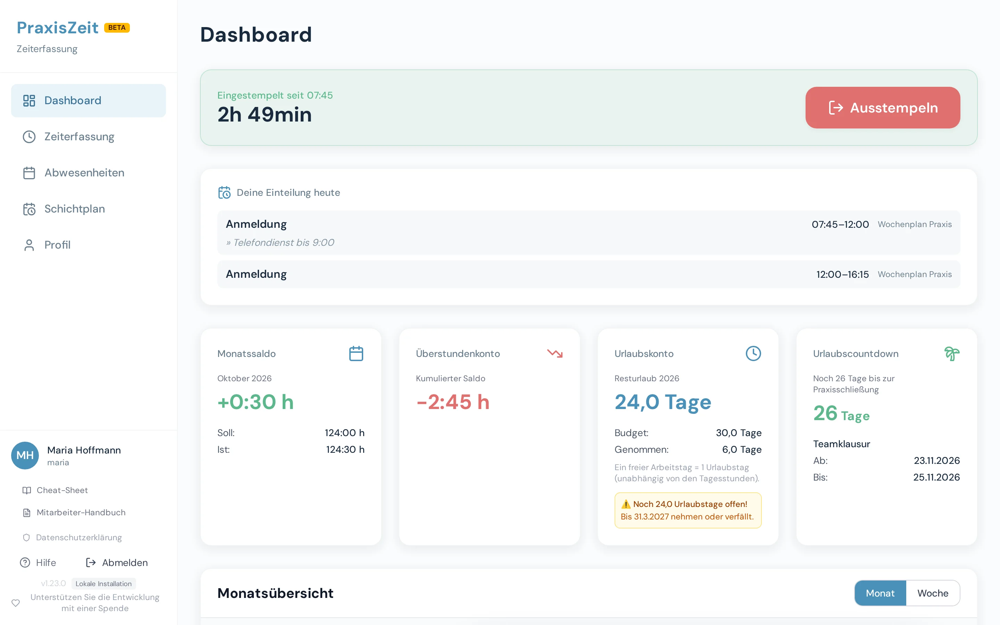

1. Die Karte **Deine Einteilung heute** zeigt je Einsatz Arbeitsplatz, Uhrzeit und Plan – und den Hinweis mit **»**, falls einer gesetzt ist.

> **Gut zu wissen:** Für welche Arbeitsplätze Sie eingewiesen sind, steht im Profil unter **Meine Einweisungen**. Einteilung und Einweisungen pflegt die Verwaltung.

## Häufige Fragen

### Ich sehe meinen gespeicherten Eintrag nicht mehr.

1. Prüfen Sie, ob der richtige Monat angezeigt wird. Blättern Sie mit den Pfeilen neben dem Monatsnamen.

### Beim Eintragen erscheint eine Warnung zur Arbeitszeit.

PraxisZeit prüft die Grenzen des Arbeitszeitgesetzes:

1. **Mehr als 8 Stunden netto:** Hinweis – zulässig, wenn es ausgeglichen wird (§ 3 ArbZG).
2. **Mehr als 10 Stunden netto:** beim Eintragen von Hand gesperrt; beim Ausstempeln nur eine Warnung, weil die Zeit schon geleistet ist.
3. **Zu kurze Pause (§ 4 ArbZG):** Speichern und Ausstempeln erst mit ausreichender Pause oder – wenn Ihre Praxis das erlaubt – mit Begründung.
4. **Überschneidung** mit einem anderen Eintrag desselben Tages: Speichern und Einstempeln sind gesperrt; der Hinweis nennt den Eintrag.

### Bei meinem Eintrag steht „gestempelt 07:30 · angerechnet ab 07:45“.

1. Für diesen Wochentag sind Arbeitszeit-Blöcke hinterlegt. Vor dem ersten und nach dem letzten Block wird nur bis zum Puffer angerechnet; Ihre Stempelzeit bleibt gespeichert. Siehe [Nicht angerechnete Zeit](#nicht-angerechnete-zeit).

### Ich will das Datum eines Eintrags ändern, aber das Feld ist grau.

1. Beim Bearbeiten bleibt das Datum fest. Löschen Sie den Eintrag und beantragen Sie den richtigen Tag über `Antrag` – siehe [Vergangenen Tag nachtragen](#vergangenen-tag-nachtragen).

### Auf dem Dashboard steht, dass meine Arbeitszeit geändert wurde.

1. Die Verwaltung hat Ihre Arbeitszeit geändert – Wochenstunden, Tagesplan oder Arbeitszeit-Blöcke. Der Hinweis nennt das Datum und, falls erfasste Einträge neu berechnet wurden, wie viele. Er verschwindet nach 30 Tagen; die Einzelheiten stehen unter [Meine Arbeitszeit](#meine-arbeitszeit).

### Wie berechnet sich mein Urlaubsanspruch?

1. Der Jahresanspruch richtet sich nach Ihren Arbeitstagen pro Woche (z. B. 5 Tage → 30 Tage, 3 Tage → 18 Tage); den genauen Wert legt die Verwaltung fest. Verbraucht wird nach Tagen: ein freier Arbeitstag ist ein Urlaubstag, ein halber Tag 0,5.

### Was passiert bei „Überstundenausgleich“?

1. Sie bauen Überstunden ab. Ihr Soll für den Tag bleibt, der Tag zählt mit 0 Ist-Stunden; die Stunden, die Sie eintragen, gehen von Ihrem Überstundenkonto ab. Urlaub wird nicht abgezogen.

### Bei mir fehlen Monatssaldo, Überstundenkonto und Stempel-Knopf. Ist das ein Fehler?

1. Nein. Für manche Mitarbeitende führt die Praxis keine Stundenzählung. Urlaub und Krankheit werden trotzdem nach Tagen geführt, und Abwesenheiten tragen Sie ganz normal ein.

### Was bedeutet ein rotes Minus beim Saldo?

1. Sie haben weniger gearbeitet als Ihr Soll. Ein grüner Wert heißt: mindestens das Soll.

### Wie trage ich Arbeit am Wochenende oder Feiertag ein, z. B. einen Notdienst?

1. **Am selben Tag:** stempeln Sie wie gewohnt oder legen Sie über `Neuer Eintrag` einen Eintrag an. An Sonn- und Feiertagen fragt das Formular nach dem **Ausnahmegrund**.
2. **Nachträglich:** über den Knopf `Antrag` oder im Journal über das **+** in der Zeile des Tages – beide fragen an Sonn- und Feiertagen nach dem `Ausnahmegrund (§10 ArbZG)`.
3. An diesen Tagen ist Ihr Soll 0 – die angerechneten Stunden erhöhen Ihren Saldo. Solche Einträge tragen in der Liste das Kennzeichen „So/FT“.

### Ich habe mein Passwort vergessen.

1. Wenden Sie sich an Ihre Verwaltung. Sie setzt Ihr Passwort zurück.
