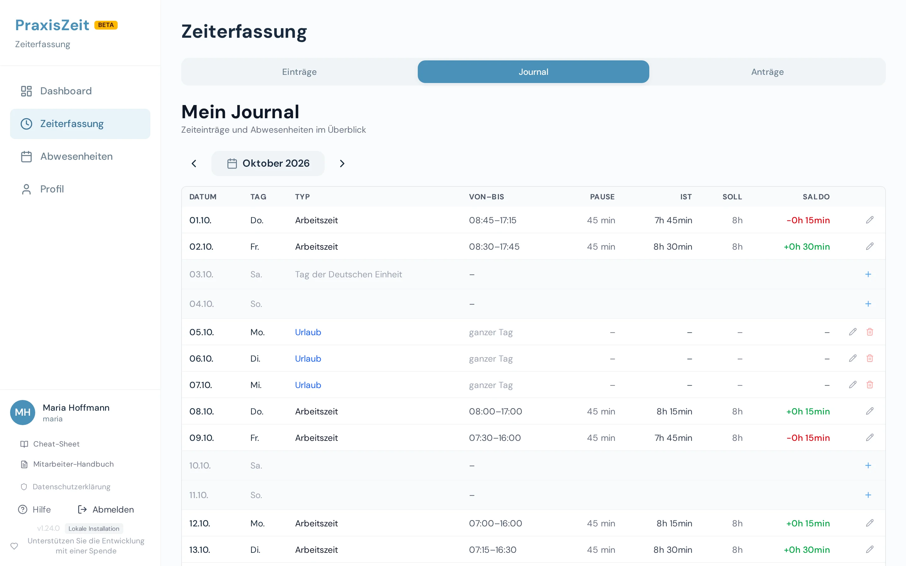
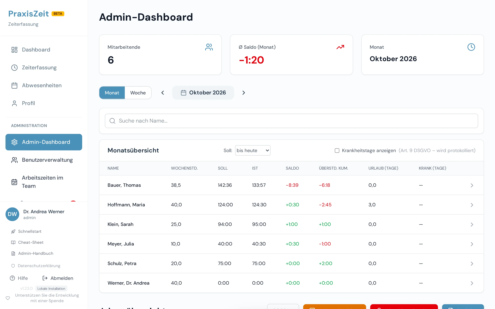
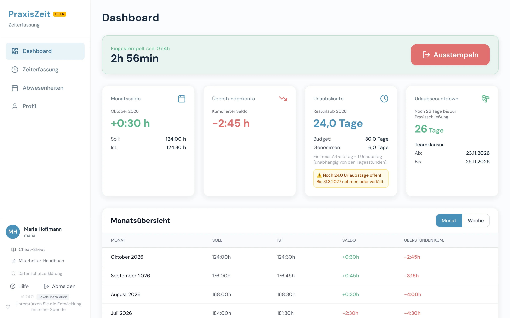

<!-- Erzeugt aus frontend/src/handbuch — nicht von Hand bearbeiten -->

# So rechnet PraxisZeit

**Stand:** PraxisZeit 1.24.0

Wie aus Stempelzeiten, Verträgen und Abwesenheiten Soll, Ist, Saldo und Urlaubskonto werden. Jedes Thema beginnt mit einem Satz, zeigt ein Bild und rechnet ein Beispiel vor; die Rechenbeispiele sind mit der echten Berechnung geprüft. PraxisZeit rechnet, was eingestellt und vereinbart ist; ob etwas rechtlich zulässig ist, regeln Gesetz, Arbeitsvertrag und Betriebsvereinbarung. Das Handbuch ersetzt keine Rechtsberatung.

## Grundbegriffe

Arbeitszeit rechnet PraxisZeit in Stunden, Urlaub in Tagen: Das Soll ist, was laut Vertrag zu arbeiten wäre, das Ist ist, was angerechnet wird, und der Saldo ist die Differenz.

*Beispiel: Vollzeit mit 8,00 h Tagessoll in einem Monat mit 22 Werktagen, 1 Feiertag und 4 Urlaubstagen. Das Ist liegt 1,50 h über dem Soll.*

| Begriff | Bedeutung |
| --- | --- |
| **Soll** | Die Stunden, die Sie an einem Tag oder in einem Monat laut Vertrag arbeiten müssten. |
| **Ist** | Die angerechnete Arbeitszeit der Zeiteinträge nach Pause und nicht angerechneter Lücke, plus gutgeschriebene Abwesenheiten (Krank, Fortbildung). |
| **Saldo** | Ist minus Soll. Positiv heißt Mehrarbeit, negativ Minusstunden. |
| **Überstundenkonto** | Die Monatssalden, über die Monate zusammengezählt. Das Konto darf negativ sein. |
| **Tagessoll** | Das Soll eines einzelnen Arbeitstags in Stunden. Es ist die Brücke zwischen Stunden und Urlaubstagen. |
| **Tagesprinzip** | Urlaub zählt in Tagen: Ein freier Arbeitstag ist ein Urlaubstag, ein halber Tag 0,5. |
| **Übertrag** | Überstundensaldo und Resturlaub, die zum Jahreswechsel ins Folgejahr gehen. |

### Wo sehe ich Soll, Ist und Saldo eines Tages?

Öffnen Sie `Zeiterfassung` und dort den Reiter `Journal`.

1. Der Reiter `Journal` zeigt jeden Tag des Monats mit Art, Von–Bis, Pause, Ist und Soll.
2. In der Spalte `Saldo` steht je Tag Ist minus Soll; am Monatsende ergibt die Summe der Tages-Differenzen in der Regel den Monatssaldo.

[Technische Details](https://github.com/phash/praxiszeit/blob/master/docs/BERECHNUNGEN.md#1-grundbegriffe): die genauen Formeln und weitere Fälle.

## Tagessoll

Das Tagessoll gilt für genau einen Tag und kommt aus Ihrem Vertrag: Wochenstunden geteilt durch Arbeitstage, ein fester Tagesplan oder die Summe Ihrer Arbeitszeit-Blöcke.

| Vertrag | Rechnung | Tagessoll |
| --- | --- | --- |
| Vollzeit, gleichmäßig | 40 h ÷ 5 Tage | 8,00 h |
| Teilzeit, gleichmäßig | 25 h ÷ 5 Tage | 5,00 h |
| Teilzeit an 3 Tagen | 24 h ÷ 3 Tage | 8,00 h |
| Individueller Tagesplan | Mo, Di, Mi je 8 h; Do, Fr 0 h | Mo bis Mi 8,00 h · Do und Fr 0,00 h |
| Arbeitszeit-Blöcke | 08:00–12:00 und 15:00–18:00, Pause 30 min (7:00 h − 30 min) | 6,50 h |
| Arbeitszeit-Block | 08:00–12:05, keine Pause (4:05 h) | 4,08 h |

Am Wochenende ist das Tagessoll immer 0. Geteilt wird durch die Zahl der Arbeitstage Ihres Vertrags, nicht fest durch 5: 24 Stunden an 3 Tagen ergeben 8 Stunden pro Tag, nicht 4,8. Bei Arbeitszeit-Blöcken ergibt sich das Tagessoll aus der Summe der Blöcke minus der Pause innerhalb der Blöcke.

> **Gut zu wissen:** Jeder Tag rechnet mit dem Vertrag, der an diesem Tag galt. Gilt eine Änderung erst ab einem späteren Datum, bleiben frühere Tage unverändert. Tragen Sie sie rückwirkend ein, rechnet PraxisZeit gebuchte Abwesenheiten und Kappungen ab dem Wirkungsdatum neu; Tage davor bleiben unverändert.

[Technische Details](https://github.com/phash/praxiszeit/blob/master/docs/BERECHNUNGEN.md#3-tagessoll-daily-target): die genauen Formeln und weitere Fälle.

## Ist und Pausen

Ihr Ist ist die Zeit zwischen Beginn und Ende, abzüglich Pause und nicht angerechneter Lücken, und nie weniger als null.

| Zeiteintrag | Pause | Ist |
| --- | --- | --- |
| 08:00–16:30 | 30 min | 8,00 h |
| 08:00–12:05 | keine | 4,08 h |
| 08:00–08:20 | 30 min | 0,00 h |

Das Ist eines Zeiteintrags wird auf zwei Nachkommastellen gerundet, deshalb ergibt 4:05 h hier 4,08 h. Ein offener Eintrag ohne Ende zählt noch 0 h. Zusätzlich zählen Krank und Fortbildung als Ist (siehe [Abwesenheiten](#abwesenheiten)).

> **Gut zu wissen:** Die Ruhepausen nach § 4 ArbZG prüft PraxisZeit je Tag; aneinandergereihte Zeiteinträge eines Tages zählen dafür zusammen. Die Lage der Pause prüft PraxisZeit nicht.

[Technische Details](https://github.com/phash/praxiszeit/blob/master/docs/BERECHNUNGEN.md#4-ist-stunden-net_hours): die genauen Formeln und weitere Fälle.

## Arbeitszeit-Blöcke und Kappung

Arbeitszeit-Blöcke legen fest, wann Zeit angerechnet wird: Was jenseits des Puffers vor dem ersten und nach dem letzten Block liegt, wird nicht angerechnet, und die Lücke zwischen zwei Blöcken, an beiden Rändern um den Puffer verkürzt, zählt nicht.

*Beispiel: Blöcke 08:00–12:00 und 15:00–16:00, Puffer 15 min, Hülle 07:45–16:15. Zeiteintrag 07:30–12:10: angerechnet ab 07:45, das Ende liegt noch im Puffer, Ist 4:25 h. Zeiteintrag 13:00–16:30: der Beginn in der Lücke bleibt, die Lücke (105 min) zählt nicht, das Ende wird auf 16:15 gekappt, Ist 1:30 h.*

| Fall | Gestempelt | Gespeichert | Lücke | Angerechnet | Nicht angerechnet |
| --- | --- | --- | --- | --- | --- |
| Durchgestempelt | 08:00–18:00 | 08:00–18:00 | 150 min | 7,50 h | 150 min |
| Ausstempeln um 12:05 | 08:00–12:05 | 08:00–12:05 | 0 min | 4,08 h | 0 min |
| Ganz in der Lücke | 12:30–14:30 | 12:30–14:30 | 120 min | 0,00 h | 120 min |
| Vor und nach der Hülle, dazu die Lücke | 07:00–19:00 | 07:45–18:15 | 150 min | 8,00 h | 240 min |
| Ganz vor der Hülle | 05:00–07:00 | 05:00–05:00 (Beginn = Ende) | 0 min | 0,00 h | 120 min |
| Durchgestempelt, 30 min Pause | 08:00–18:00 | 08:00–18:00 | 150 min | 7,00 h | 150 min |
| Werktag ohne Arbeitszeit-Block (Dienstag) | 09:00–12:00 | 09:00–09:00 (Beginn = Ende) | 0 min | 0,00 h | 180 min |

Die Tabelle rechnet mit den Blöcken Montag 08:00–12:00 und 15:00–18:00 (anders als im Bild) und 15 min Puffer; die Hülle reicht dann von 07:45 bis 18:15. Der Werktag ohne Block ist ein Dienstag, an dem der Vertrag keinen Block vorsieht.

**Puffer:** Vor dem ersten und nach dem letzten Block gilt ein Puffer, Standard 15 Minuten. **Hülle:** erster Block minus Puffer bis letzter Block plus Puffer; was außerhalb liegt, wird auf die Hülle verschoben, ganz außerhalb zählt 0 h. **Lücke:** die Zeit zwischen zwei Blöcken, an beiden Rändern um den Puffer verkürzt; ist sie höchstens doppelt so lang wie der Puffer, verschwindet sie. Ihre gestempelten Zeiten bleiben gespeichert.

> **Achtung:** Die Kappung ist die Voreinstellung der Anrechnung, keine Aussage darüber, was Arbeitszeit ist: Tatsächlich angeordnete oder geduldete Arbeit ist Arbeitszeit, die Praxisleitung sollte sie anerkennen. Ein Werktag, an dem Ihr Vertrag keinen Block vorsieht, zählt 0 h, bis die Zeit anerkannt wird. Die gestempelten Zeiten bleiben immer gespeichert. Keine Kappung gibt es an Wochenenden, an Feiertagen, an freien Sondertagen, für Mitarbeitende ohne Stundenzählung und bei Arbeitszeiten, die aus einer älteren Version stammen (ein Block je Tag ohne Pause): Dort bleibt ein Tag ohne Fenster ungekappt.

[Technische Details](https://github.com/phash/praxiszeit/blob/master/docs/BERECHNUNGEN.md#41-arbeitszeit-blöcke-und-kappung): die genauen Formeln und weitere Fälle.

## Monatssoll und Saldo „bis heute“

Der Monatssaldo ist Ist minus Soll; das Überstundenkonto addiert die Monatssalden, und die Anzeige rechnet bis heute, wenn heute schon ausgestempelt wurde, sonst bis gestern.

*Beispiel: Januar und Februar entsprechen den Rechenbeispielen unten, März und April sind frei gewählte Beispielwerte. Die Linie ist das Überstundenkonto.*

| Schritt | Rechnung | Ergebnis |
| --- | --- | --- |
| Soll | 22 Werktage − 1 Feiertag − 4 Urlaubstage = 17 Tage × 8,00 h | 136,00 h |
| Ist | 14 Tage × 8,00 h + 3 Tage × 8,50 h | 137,50 h |
| Saldo | 137,50 h − 136,00 h | \+1,50 h |
| Monat mit einem Tag Überstundenausgleich (Beispiel Februar) | 19 Tage × 8,00 h gearbeitet, 1 Tag Ausgleich, Soll 20 × 8,00 h | −8,00 h |
| Überstundenkonto | Januar +1,50 h, Februar −8,00 h | Ende Januar +1,50 h · Ende Februar −6,50 h |

**Stichtag „bis heute“:** Live-Anzeigen rechnen Soll und Ist bis zum Stichtag, damit der Monat nicht am Ersten mit einem vollen Monats-Soll gegen ein leeres Ist beginnt. Heute zählt erst, wenn für heute ein ausgestempelter Zeiteintrag existiert, sonst ist der Stichtag gestern.

| Situation | Stichtag |
| --- | --- |
| Beispiel: Heute (11.03.) ist bereits ausgestempelt | 11\.03. |
| Beispiel: Heute (11.03.) ist noch nicht ausgestempelt | 10\.03. |

### Wo sehe ich meinen Saldo?

Das `Dashboard` zeigt Ihre Zahlen bis zum Stichtag.

1. `Monatssaldo`: Ist minus Soll des laufenden Monats.
2. `Überstundenkonto`: Ihr Konto, also die Monatssalden zusammengezählt.

### Wo stelle ich als Praxisleitung den Stichtag um?

Im `Admin-Dashboard` steht über der Übersicht der Schalter `Soll`.

1. Wählen Sie bei `Soll` zwischen „bis heute“ und „Monatsende“.
2. Die Spalte `Saldo` rechnet danach bis zum Stichtag oder für den vollen Monat.

> **Gut zu wissen:** Datei-Exporte, Monatsjournal und Jahresabschluss rechnen immer den vollen Zeitraum ohne Stichtag, damit ein Beleg nie von einer Live-Anzeige abweicht.

[Technische Details zum Stichtag](https://github.com/phash/praxiszeit/blob/master/docs/BERECHNUNGEN.md#74-saldo-stichtag-bis-heute-313): die genauen Formeln und weitere Fälle.

[Technische Details zum Monats-Soll](https://github.com/phash/praxiszeit/blob/master/docs/BERECHNUNGEN.md#5-monats-soll): die genauen Formeln und weitere Fälle.

## Abwesenheiten

Jede Art von Abwesenheit wirkt anders auf Soll, Ist und Urlaubskonto; die Tabelle zeigt es für einen Tag mit 8,00 h Soll.

| Art | Soll | Ist | Saldo des Tages | Urlaubstage | Wirkung |
| --- | --- | --- | --- | --- | --- |
| Urlaub | 0,00 h | 0,00 h | ±0,00 h | 1 Tag | Soll sinkt, ein Urlaubstag wird verbraucht |
| Krank | 8,00 h | 8,00 h | ±0,00 h | 0 Tage | Soll bleibt, die Stunden zählen als Ist |
| Fortbildung | 8,00 h | 8,00 h | ±0,00 h | 0 Tage | Soll bleibt, die Stunden zählen als Ist |
| Bezahlte Freistellung | 0,00 h | 0,00 h | ±0,00 h | 0 Tage | Soll sinkt, kein Urlaubstag |
| Sonstiges (auch unbezahlt entschuldigt) | 0,00 h | 0,00 h | ±0,00 h | 0 Tage | Soll sinkt, kein Urlaubstag; ob die Zeit bezahlt wird, regelt der Vertrag |
| Überstundenausgleich | 8,00 h | 0,00 h | −8,00 h | 0 Tage | Soll bleibt, Ist ist 0: das Überstundenkonto sinkt |

Gebucht werden bei jeder Art außer Überstundenausgleich die Stunden des Tagessolls. Krank und Fortbildung zählen nur dort als Ist, wo auch ein Soll steht: An Wochenenden und Feiertagen gibt es keine Gutschrift, an einem halben Feiertag die Hälfte. Unter den Abwesenheitsarten senkt nur der Überstundenausgleich das Überstundenkonto; im Modus mit festem Monats-Soll (siehe [Minijob](#minijob)) gelten eigene Regeln.

[Technische Details](https://github.com/phash/praxiszeit/blob/master/docs/BERECHNUNGEN.md#6-abwesenheits-typen-matrix): die genauen Formeln und weitere Fälle.

## Urlaubskonto

Urlaub rechnet PraxisZeit in Tagen: Anspruch plus Übertrag minus genommene Tage ergibt den Rest, und ein freier Arbeitstag kostet genau einen Tag.

*Beispiel mit 2 Übertragstagen. Ohne Übertrag blieben nach 4 genommenen Tagen 26 Tage übrig, mit Übertrag 28.*

| Posten | Rechnung | Ergebnis |
| --- | --- | --- |
| Beispiel Vollzeit, ohne Übertrag | 30 Tage Anspruch − 4 Tage genommen | Rest 26 Tage |
| Beispiel mit Übertrag (wie im Diagramm) | 30 Tage Anspruch + 2 Tage Übertrag = 32 Tage Budget − 4 Tage genommen | Rest 28 Tage |
| Vorschlag beim Anlegen einer Person mit 3 Arbeitstagen pro Woche (überschreibbar) | 30 × 3 ÷ 5 | 18 Tage |
| Urlaub am 24.12. als „halber Feiertag“ | Tagesprinzip: halber Tag | 0,5 Tage |
| Beispiel: Eintritt am 15.04., Anspruch 30 Tage | 30 × (8 + 16/30) ÷ 12, also 8 volle Monate plus 16 von 30 Tagen im April | 21,3 Tage |
| Frist für den Resturlaub aus 2026 (Standard) | 31\. März des Folgejahres | 31\.03.2027 |
| Teilzeit Mo–Mi, eine ganze Urlaubswoche (Mo–Fr) | nur Tage mit Soll zählen | 3 Tage |

Ein Urlaubstag kostet einen Tag, egal wie lang der Tag laut Vertrag ist; ein Halbtag kostet 0,5. Wochenenden, Feiertage und Tage ohne Soll kosten nichts. 30 Tage Anspruch sind ein Beispiel für einen vertraglichen Anspruch. Die Eintritts-Rechnung ist die taggenaue Regel von PraxisZeit; gesetzliche und vertragliche Regeln können abweichen. Die Praxisleitung kann für einzelne Personen eine andere Frist hinterlegen (ein festes Datum, das für alle Jahre gilt). **Frist:** Das ist die Voreinstellung von PraxisZeit. Ob Resturlaub tatsächlich verfällt, setzt nach § 7 Abs. 3 BUrlG voraus, dass die Praxis ihre Mitarbeitenden rechtzeitig auf den drohenden Verfall hingewiesen und zum Urlaubnehmen aufgefordert hat; die Warnung in PraxisZeit ersetzt diesen Hinweis nicht.

### Wo sehe ich meinen Resturlaub?

Das `Dashboard` zeigt Ihr Urlaubskonto.

1. `Urlaubskonto`: Budget (Anspruch plus Übertrag), genommene Tage und Resturlaub in Tagen.

[Technische Details](https://github.com/phash/praxiszeit/blob/master/docs/BERECHNUNGEN.md#8-urlaubskonto): die genauen Formeln und weitere Fälle.

## Betriebsferien

Betriebsferien bucht PraxisZeit für alle Teilnehmenden automatisch als Urlaub oder als bezahlte Freistellung; mit der Einstellung „Überzählige Betriebsferien als Überstundenabbau“ folgt bei Mitarbeitenden mit Stundenzählung auf den letzten Urlaubstag der Überstundenausgleich.

*Beispiel: 3 Tage Resturlaub vor einer Schließung von Montag bis Freitag, Einstellung eingeschaltet. Die Tage werden der Reihe nach gebucht.*

| Tag | Urlaubsbudget vorher (nach Abzug des übrigen Urlaubs im Jahr) | Buchung | Urlaubsbudget nachher |
| --- | --- | --- | --- |
| Mo | 3 Tage | Urlaub | 2 Tage |
| Di | 2 Tage | Urlaub | 1 Tag |
| Mi | 1 Tag | Urlaub | 0 Tage |
| Do | 0 Tage | Überstundenausgleich | 0 Tage |
| Fr | 0 Tage | Überstundenausgleich | 0 Tage |

| Fall | Rechnung | Ergebnis |
| --- | --- | --- |
| Überstundenkonto nach der Schließung | 2 Tage Überstundenausgleich × 8,00 h | −16,00 h |
| Einstellung aus | alle 5 Tage als Urlaub | Resturlaub −2 Tage |

Gebucht wird nicht an Wochenenden, Feiertagen, Tagen ohne Tagessoll, freien Sondertagen, Tagen außerhalb Ihrer Beschäftigung und Tagen, an denen schon eine andere Abwesenheit steht. Die Einstellung ist standardmäßig aus; schalten Sie sie ein, müssen die Betriebsferien einmal erneut gespeichert werden, damit die Tage neu aufgeteilt werden. Wer die Schließung als bezahlte Freistellung buchen lässt, verbraucht keinen Urlaub. Die Aufteilung gilt nur für Mitarbeitende mit Stundenzählung; alle anderen bekommen immer Urlaub.

> **Achtung:** PraxisZeit bucht, was eingestellt ist. Ob ein Vorgriff auf künftigen Urlaub (Minus-Urlaub) oder ein Überstundenabbau zulässig ist, regeln Arbeitsvertrag und Betriebsvereinbarung; bei einseitig angeordneten Betriebsferien trägt die Praxis grundsätzlich das Vergütungsrisiko (§ 615 BGB). Im Zweifel fragen Sie eine Fachanwältin oder einen Fachanwalt für Arbeitsrecht.

[Technische Details](https://github.com/phash/praxiszeit/blob/master/docs/BERECHNUNGEN.md#94-betriebsferien-über-jahresurlaub-hinaus--überstundenausgleich-314): die genauen Formeln und weitere Fälle.

## Sondertage und verkürzte Tage

Der 24. und 31.12. sowie frei gewählte verkürzte Tage verändern das Soll und die Kosten eines Urlaubstags, nicht aber Ihre gestempelte Zeit.

| 24\.12. eingestellt als | Tagessoll bei 8 h pro Tag | Urlaubskonto |
| --- | --- | --- |
| Arbeitstag | 8,00 h | 1 Tag |
| Halbtag (halber Feiertag) | 4,00 h | 0,5 Tage |
| Frei, als Urlaub gewertet | 0,00 h | Kein Urlaub zu buchen; 1 Tag wird automatisch vom Urlaubskonto abgezogen |
| Frei, als bezahlte Freistellung gewertet | 0,00 h | Kein Urlaub zu buchen; 0 Tage werden abgezogen |
| Verkürzt auf 4 Stunden | 4,00 h | 0,5 Tage |

| Fall | Soll | Ist | Saldo |
| --- | --- | --- | --- |
| Krank am 24.12., verkürzt auf 4 Stunden | 4,00 h | 4,00 h | ±0,00 h |

Bei „Verkürzt auf X Stunden“ gilt das Tagessoll als Höchstgrenze: Wer an dem Tag ohnehin weniger Soll hat, behält es, bei 3 h Tagessoll und einer Grenze von 4 Stunden bleibt es bei 3,00 h. Dieselbe Regel gilt für Tage, die Sie unter `Verkürzte Tage` in den Einstellungen eintragen, zum Beispiel Rosenmontag. Ein Feiertag geht vor, am Wochenende wirkt ein verkürzter Tag nicht. Ob ein betriebsfreier Tag auf den Urlaub angerechnet werden darf, regeln Arbeitsvertrag und Betriebsübung.

> **Gut zu wissen:** Ändern Sie einen verkürzten Tag oder die Einstellung für den 24./31.12., bucht PraxisZeit die betroffenen Betriebsferien neu. In bereits abgeschlossenen Jahren erscheint nur ein Hinweis.

[Technische Details](https://github.com/phash/praxiszeit/blob/master/docs/BERECHNUNGEN.md#122-sondertage-2412--3112-146): die genauen Formeln und weitere Fälle.

## Minijob und Mindestlohn

Für Minijobs mit Arbeitszeitkonto warnt PraxisZeit nur, ohne zu sperren, wenn die Plusstunden eines Monats die Hälfte der vereinbarten Monatszeit übersteigen oder Guthaben älter als zwölf Monate wird.

| Fall | Rechnung | Ergebnis |
| --- | --- | --- |
| Beispiel: 10 h pro Woche vereinbart, 66 h erfasst | Monatszeit 10 × 13 ÷ 3 = 43,33 h; Grenze 21,67 h; Plusstunden 66 − 43,33 = 22,67 h | Warnung |

| Gültig ab | Mindestlohn |
| --- | --- |
| Gesetzlicher Mindestlohn ab 01.01.2026 | 13,90 € pro Stunde |
| Gesetzlicher Mindestlohn ab 01.01.2027 | 14,60 € pro Stunde |

Die vereinbarte Monatszeit ist, wenn nichts anderes hinterlegt ist, die Wochenstundenzahl mal 13 geteilt durch 3. Die Warnungen blockieren nie das Stempeln oder Buchen und gelten, sofern die Stunden zur Mindestlohnhöhe vergütet werden; PraxisZeit speichert keine Lohndaten und zeigt den Mindestlohn nur zur Information an. Mit festem Monats-Soll gilt die vereinbarte Monatszeit als Soll des Monats.

[Technische Details](https://github.com/phash/praxiszeit/blob/master/docs/BERECHNUNGEN.md#10-minijob--milog-arbeitszeitkonto): die genauen Formeln und weitere Fälle.

## Jahresabschluss

Der Jahresabschluss friert Ihren Überstundensaldo und Ihren Resturlaub zum 31.12. als Übertrag ins Folgejahr ein, und ein erneuter Abschluss überschreibt ihn, auch von Hand angepasste Überträge.

Beispiel: Vollzeit mit 30 Tagen Anspruch, im Dezember 2025 eine Stunde Mehrarbeit und 4 genommene Urlaubstage.

| Situation | Überstunden-Übertrag | Urlaubs-Übertrag |
| --- | --- | --- |
| Erster Abschluss 2025 | \+1,00 h | 26 Tage |
| Nach nachträglicher Änderung (+1,00 h) erneut abgeschlossen | \+2,00 h | 26 Tage |

Ändert sich ein abgeschlossenes Jahr nachträglich, zum Beispiel durch einen stornierten Urlaub, rechnet PraxisZeit den Übertrag nicht von selbst neu, sondern weist auf den veralteten Übertrag hin. Mit einem erneuten Jahresabschluss übernehmen Sie die neuen Werte. Der Abschluss schließt auch Mitarbeitende ohne Stundenzählung ein, für sie zählt der Resturlaub.

[Technische Details](https://github.com/phash/praxiszeit/blob/master/docs/BERECHNUNGEN.md#11-jahresabschluss--carryover): die genauen Formeln und weitere Fälle.
